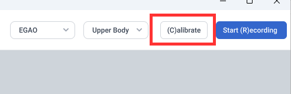

# Calibration

## What Calibration Does

If the camera is tilted at an angle (for example, forward or backward), the avatar's body posture may be off. Calibration compensates for the camera tilt.

Calibration also moves the person to the origin, making it easier to align with the scene.

Additionally, individual facial features may introduce baseline deviations that affect expression accuracy. Calibration allows for more accurate detection of dynamic facial expressions.

## How to Calibrate

Click the **Calibrate** button or press the **C** key to start calibration.

During calibration, sit or stand at the origin of the capture area, relax your body and facial expression, let your arms hang naturally, and look straight ahead.

Once the countdown ends and the "Calibration Completed" message appears, you can begin normal motion capture.

## Calibrating Without a Person in Frame

If no one is in the frame during calibration, MONO compensates for the camera tilt based on the image. In this case, the person's position and facial expressions are not calibrated.

## When Calibration Fails

If no one is in the frame and the scene is a single solid color (such as a green screen), MONO cannot determine the camera tilt from the image, and calibration cannot be completed. Step into the frame and calibrate again.
