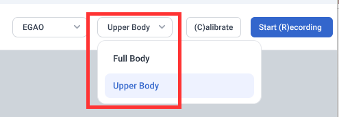

# Motion Capture Mode

Dollars MONO offers two motion capture modes, **Upper Body** and **Full Body**. Click the button shown below to switch between them according to your needs.

## Upper Body Mode

Suitable for live streaming or recording at a desk, where only upper-body motion needs to be captured.

## Full Body Mode

Suitable for standing performances, dancing, and other scenarios that require full-body motion capture.
