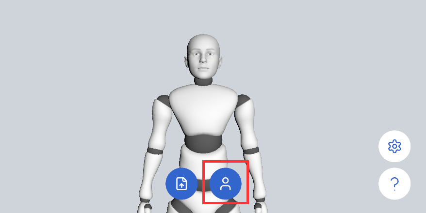

# Calibration

## What Calibration Does

If the device is tilted at an angle (for example, forward or backward), the avatar's body posture may be off. Calibration helps correct this.

Additionally, individual facial features may introduce baseline deviations that affect expression accuracy. Calibration allows for more accurate detection of dynamic facial expressions.

In full-body capture mode, calibration also moves the avatar to the origin, making it easier to align with the scene.

## How to Calibrate

Click the button at the bottom of the program to start calibration.

During calibration, relax your body and facial expression, let your arms hang naturally, and look straight ahead.

In full-body capture mode, stand naturally in the center of the capture area and make sure your whole body from head to feet is in frame.

Once the countdown ends and the "Calibration Complete" message appears, you can begin normal motion capture.

You can cancel calibration at any time by clicking the same button again.

## Calibration Demo

The following shows a full-body calibration. Once calibration is complete, the avatar moves to the scene origin.

<video controls width="50%">
  <source src="/saya-fullbody-calibration.mp4"/>
</video>
