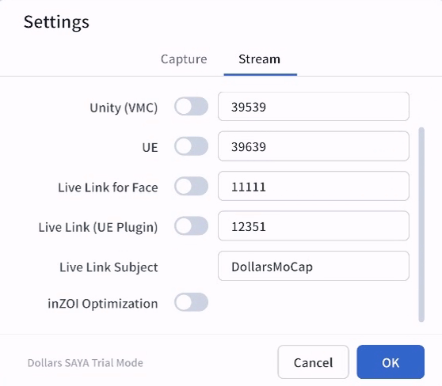

---
sidebar_position: 10
title: Get Started
className: translation-complete
---	

# Get Started

## Device Placement

For the best capture results, place your device according to your tracking mode, and try to keep it roughly upright without much forward or backward tilt.

### Upper-Body Mode

- **Position**  
  Place the device in front of your body, at roughly face height.

- **Framing**  
  When your hands are at rest (for example, hanging down or when you're using a mouse or keyboard), make sure they are outside the camera frame.  
  When you raise your hands, both should be fully visible within the camera frame.

  If space allows, step slightly back to achieve a more complete capture range.

### Full-Body Mode

- **Position**  
  Place the device directly in front of you, at roughly waist height, and keep enough distance from your body.

- **Framing**  
  Your whole body from head to feet should stay in frame, and your feet should not leave the frame while you move.  
  Leave enough room to move so that you do not step out of the camera's view.

### Orientation

SAYA starts in landscape left by default. To capture in a different orientation, turn off rotation lock in Control Center, then rotate the device to the angle you need.

## Capture Environment

### Lighting

Shoot in bright, even lighting so that your face, hands, and body outline are clearly visible. Avoid strong backlight, dark environments, or frequently changing light to reduce tracking errors.

### Background

Choose a simple, tidy background, and avoid objects that resemble your movements or other people moving in the background. Keep a clear color contrast between your body and the background to help the system detect body and hand key points more accurately.

### Clothing

Wear clothes that contrast clearly with the background, and avoid tops or trousers that are close to the background color. Avoid clothing that is too loose, hides your body outline, or is highly reflective.

## Connect to Computer

After placing your device, follow the steps below to connect to your computer.

1. Open the Dollars SAYA app and go to the Settings page.  
2. In the “Target IP” field, enter your computer’s local network IP address.  
3. Once confirmed, tap Save.

> **Tip**  
> When connecting via USB, your device may be assigned a new IP address.  
> If that happens, please re-enter the updated IP address in the settings.

## Streaming to PC Software

Dollars SAYA can stream real-time capture data to PC programs or VTuber software.

In the SAYA settings page, turn on the switch for the corresponding protocol to stream capture data to software on your computer in real time.

- **VMC**: For VTuber software, virtual avatars, or Unity integration.
- **UE**: For driving Unreal Engine characters via the Dollars MoCap OSC plugin.
- **Live Link for Face**: For real-time facial capture in Unreal Engine.
- **Live Link(UE Plugin)**: For driving Unreal Engine characters via the Dollars MoCap Live Link plugin.

## Tips

### Device Optimization

**Improve Network Stability**  
If wireless streaming feels unstable, use a wired Ethernet adapter (Lightning/USB-C to RJ45) to connect your device directly to the router.  
This significantly reduces latency and prevents Wi-Fi interruptions.

**USB Mode**  
You can also connect directly to your computer via USB cable.  
In this mode, it’s recommended to enable Airplane Mode to avoid calls or notifications interrupting your session.

**Monitor Device Temperature**  
The device may heat up after long periods of operation. We have implemented multiple optimizations to reduce heat generation, but the device temperature may still rise during extended use.  
We recommend

- Using cooling accessories such as a small fan.
- Testing in advance, for longer than your planned live stream, to understand how your device handles heat during extended use.  