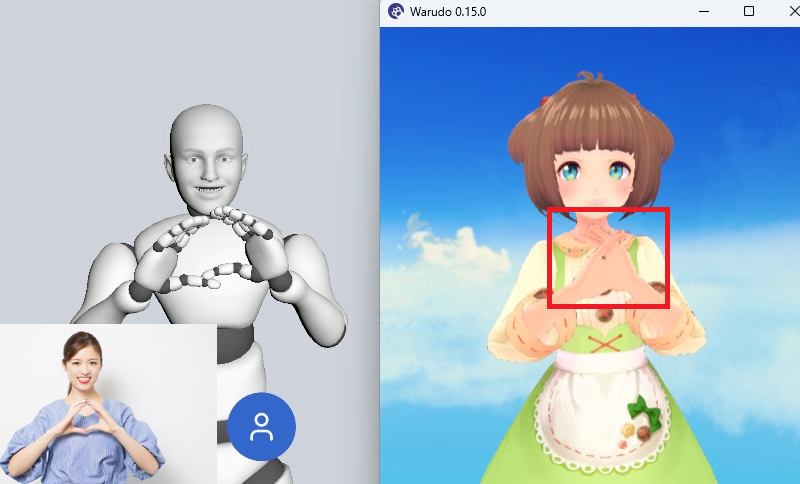
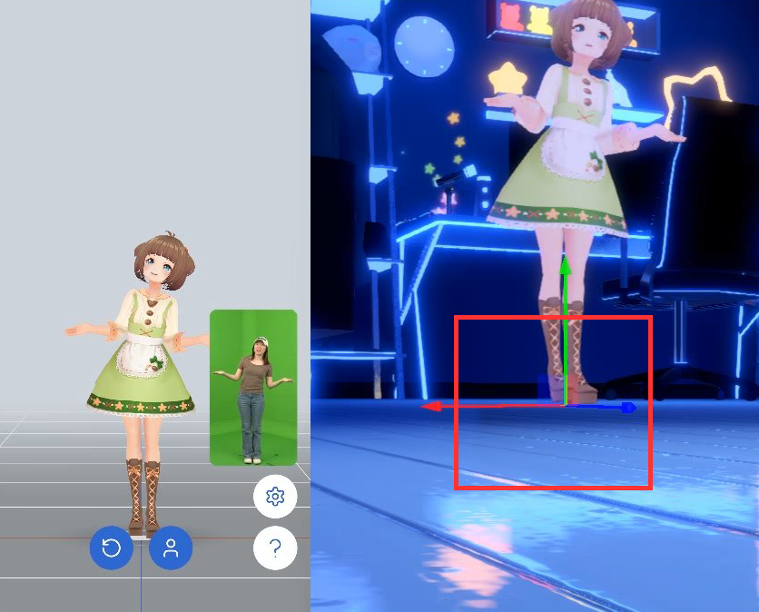

# Load VRM

## What Loading a VRM Does

By default, SAYA solves motion based on the body proportions of the built-in Dollars MoCap model. If your character differs significantly from the built-in model in proportions such as shoulder width and arm length, the motion may be off. For example, in poses that require precise alignment, such as pressing both hands together, the hands may not meet correctly or may even clip into each other.

In addition, if your character's waist height differs significantly from the built-in model, foot placement may be off, causing the feet to sink into the floor or float above it.

After you load your VRM model, SAYA solves motion based on that model's bone proportions, so the motion fits your character's own body shape and reduces misaligned hands, clipping, and foot placement problems.

## Steps

1. Transfer your character's VRM file to your device, for example via AirDrop, cloud storage, or a USB cable.
2. In SAYA, tap the button below and choose your VRM in the dialog.

Once loaded, the VRM will load automatically every time SAYA starts.

:::info

Loading a VRM only affects the output of the Unity (VMC) protocol. Other protocols are not affected.

:::
