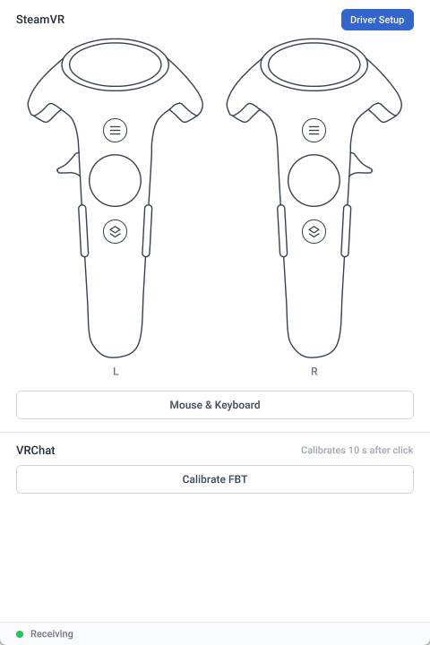
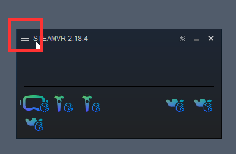
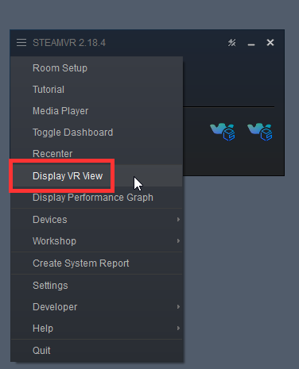

# Controllers and Mouse & Keyboard

## Controller Buttons

Two controllers are shown at the top of the Bridge main screen. L on the left is the left hand, and R on the right is the right hand. Press and hold a button on the controller image with the mouse to simulate pressing that button on the controller. Release the mouse to release the button.

- The available buttons are the menu button, system button, trigger, trackpad and grip button.
- Trackpad: the position you press corresponds to the finger position on the trackpad. Press and drag the mouse to move that position.
- Pressed buttons are shown in blue.

## Viewing Button Input

In SteamVR's VR View, you can see the virtual controllers and the effect of each button press.

1. Click the ☰ menu button in the upper left corner of the SteamVR window.

   

2. Select **Display VR View**.

   

The virtual controllers are then shown in the VR View window. When you press a button in Bridge, you can see the corresponding effect there.

### Trigger

<video controls width="100%">
  <source src="/steamvr-trigger.mp4"/>
</video>

### Trackpad

<video controls width="100%">
  <source src="/steamvr-trackpad.mp4"/>
</video>

### System Button

<video controls width="100%">
  <source src="/steamvr-system-button.mp4"/>
</video>

## Mouse & Keyboard Control

To simplify operation, Bridge provides Mouse & Keyboard control. Click **Mouse & Keyboard** on the main screen to control the headset and controllers directly with the mouse and keyboard.

| Action | Description |
| --- | --- |
| Move the mouse | Look around. |
| Left click | Press the trigger. |
| Esc | Exit Mouse & Keyboard control. The headset and hands return to motion capture control. |
