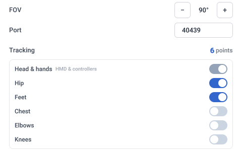
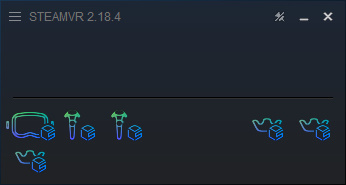
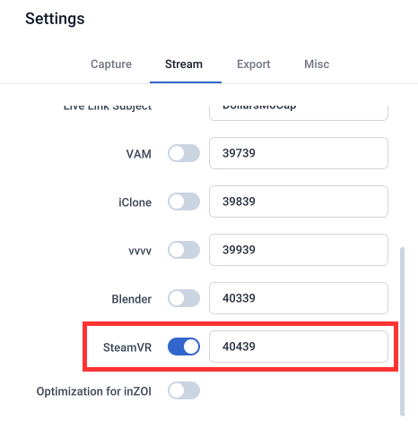
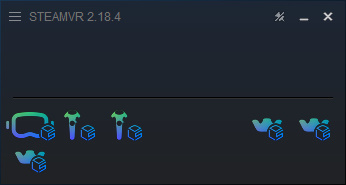

# SteamVR

:::info
Supported by Dollars MONO and Dollars SAYA since v.261110.

The driver installation steps below assume that no physical headset is installed. If a physical headset is already set up on your computer, please refer to the SteamVR documentation on running two VR systems.
:::

Before you begin, install SteamVR through Steam, and download the **Dollars MoCap SteamVR Plugin** (the program is named DollarsMoCapSteamVRBridge, Bridge for short) from the [Dollars MoCap website](https://www.dollarsmocap.com/download#plugins).

## Install the Driver

1. Place the Bridge folder in a permanent location. The driver is loaded from the folder where Bridge is located, so if you move the folder after installation, you will need to install the driver again.
2. Close SteamVR.
3. Open Bridge and click **Driver Setup** in the upper right corner.
4. Change the settings as needed, then click **Install**.

| Setting | Description |
| --- | --- |
| FOV | Vertical field of view of the virtual headset. The default is 90°. |
| Port | Port used to receive motion capture data. The default is 40439, and it must match the SteamVR port in MONO or SAYA. |
| Tracking | Head and hands are always enabled, and other body parts can be selected as needed. 6-point tracking (head, hands, hip and feet) is enabled by default. We recommend starting with this configuration and adding more tracking points once you are familiar with it. The total number of tracking points is shown on the right. |

After installation, start SteamVR. The Dollars MoCap virtual headset and tracker icons appear in the SteamVR window. Since no motion capture data has been received yet, the icons are shown as outlines only.

## Dollars MoCap Settings

On the **Stream** tab in Settings, enable SteamVR and make sure the port matches the port in Bridge's driver setup (40439 by default).

Once streaming starts, the headset, controller and tracker icons in the SteamVR window become solid, indicating that motion capture data is being received.

- If Dollars MoCap and SteamVR run on different computers, set the target IP in Dollars MoCap to the IP address of the computer running SteamVR. Bridge must run on the same computer as SteamVR.
- When Bridge receives motion capture data, **Receiving** is shown at the bottom of the window.
- SteamVR always receives the actual left and right hand data, regardless of the mirror setting.

## Uninstall

Close SteamVR, then click **Uninstall** on the driver setup page. Bridge removes the driver's registration, along with the room and tracker settings written by this driver. Other drivers and settings are not affected.
