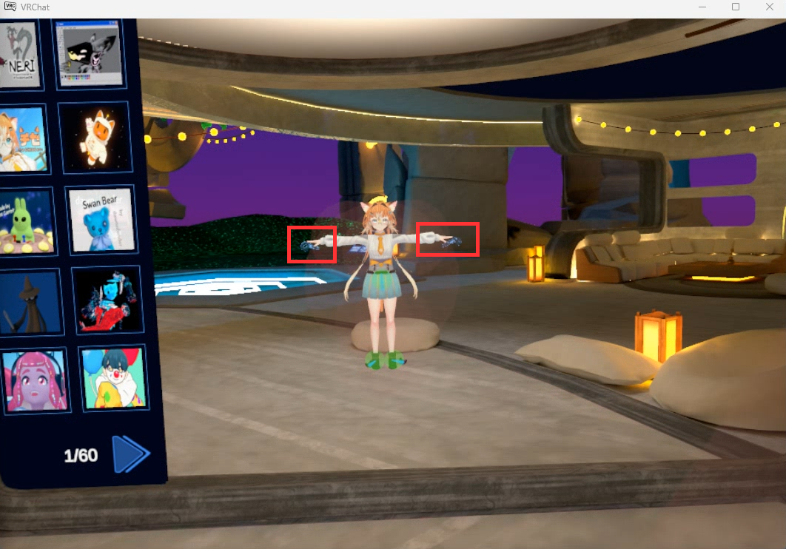
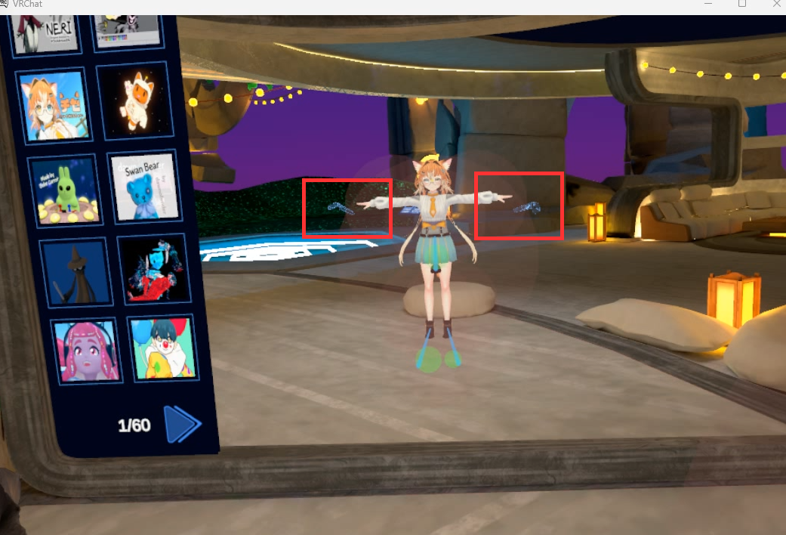

# Full-Body Calibration

## First-Time Setup

Before your first calibration, set **User Real Height** to 5' 11" (1.80 m) in the **Tracking & IK** settings of the Main Menu. This is the height of the avatar in Dollars MoCap, and matching it helps your VRChat avatar reproduce your motion more accurately.

You only need to set this once. There is no need to set it again for later calibrations.

<video controls width="100%">
  <source src="/vrchat-fbt-real-height.mp4"/>
</video>

## Calibration Steps

1. Complete motion capture calibration in your Dollars MoCap product.
2. In Bridge, click **Mouse & Keyboard**, press Q to open the Quick Menu, then click **Calibrate** in the VRChat Quick Menu.
3. Press Esc to exit Mouse & Keyboard control. The head and hands return to motion capture control. Then click **Calibrate FBT** in Bridge, and during the 10 second countdown, stand up straight and raise both arms out to the sides.
4. When the countdown ends, Bridge automatically pulls both controller triggers at the same time to complete VRChat full-body calibration.

### 1. Motion Capture Calibration in Dollars MoCap, Using MONO as an Example

<video controls width="100%">
  <source src="/vrchat-fbt-mocap-calibration.mp4"/>
</video>

### 2. Open the Quick Menu and Click Calibrate

<video controls width="100%">
  <source src="/vrchat-fbt-calibrate.mp4"/>
</video>

### 3. Click Calibrate FBT and Raise Your Arms

<video controls width="100%">
  <source src="/vrchat-fbt-countdown.mp4"/>
</video>

### 4. Full-Body Calibration Complete

<video controls width="100%">
  <source src="/vrchat-fbt-done.mp4"/>
</video>

## Adjusting the Arm Ratio

During calibration, the VR controllers shown in VRChat should roughly line up with your avatar's hands.

If the controllers are clearly outside your avatar's hands,

increase **Arm vs Height Ratio** in the **Tracking & IK** settings of the Main Menu,

<video controls width="100%">
  <source src="/vrchat-fbt-arm-ratio.mp4"/>
</video>

then calibrate again.

Conversely, if the controllers are inside your avatar's arms, decrease **Arm vs Height Ratio** slightly.
