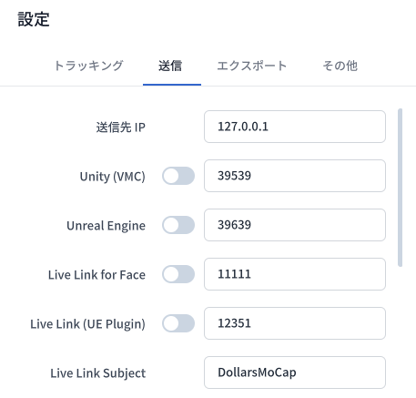
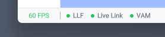
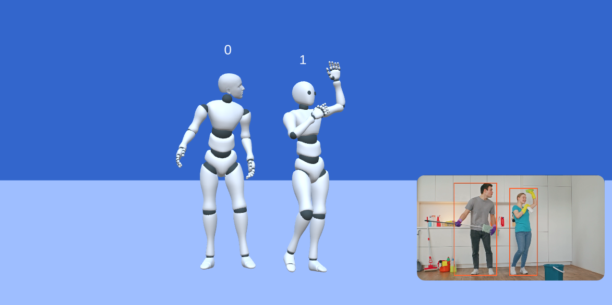
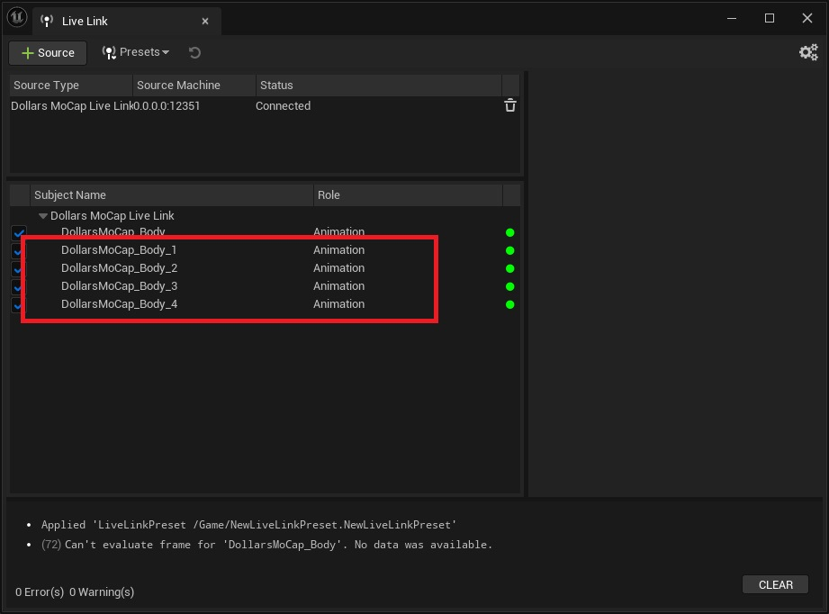

# 他のアプリケーションへのストリーミング

## ストリーミング設定

**送信** の各オプションで、エンジンごとに送信の有効と無効を切り替えることができます。

**送信先 IP** は、エンジンを実行しているコンピュータの IP アドレスです。モーションキャプチャとエンジンを同じコンピュータで実行する場合は、デフォルトの 127.0.0.1 のままにしてください。

各エンジンの **ポート**（**Unity ポート**、**Unreal Engine ポート** など）は、Dollars MoCap のエンジンプラグインが待ち受けるポートです。

現在有効になっているストリーミングオプションは、プログラムの左下に表示されます。

## 複数人モーションキャプチャ

複数人モーションキャプチャを有効にすると、各アバターの上に 0 や 1 などの番号が表示されます。

### UE Live Link プラグイン

Live Link プラグインを使用すると、1 つのモーションキャプチャソースに最大 5 つの Subject が表示されます。

Subject の番号はモーションキャプチャプログラム内の番号と一致しているため、対応する Subject を選択して各キャラクターを動かしてください。

### その他のプラグイン

その他のプラグインでは、各アバターのモーションがそれぞれ個別のポートでストリーミングされます。ポート番号は設定したポートから始まり、アバター番号に応じて 1 ずつ増えていきます。

たとえば、ポートを 39639 に設定した場合、アバター 0 は 39639、アバター 1 は 39640 というように、順番にストリーミングされます。

サードパーティ製のプログラムでこれらのポートごとにレシーバーを追加すると、複数のキャラクターを同時に動かすことができます。
