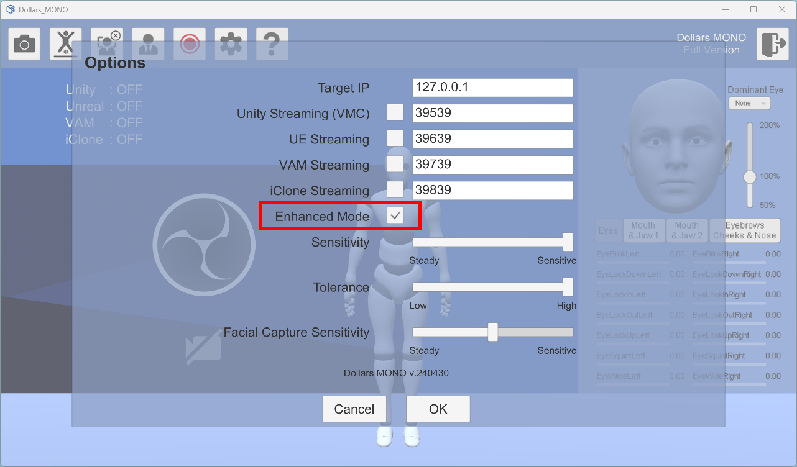
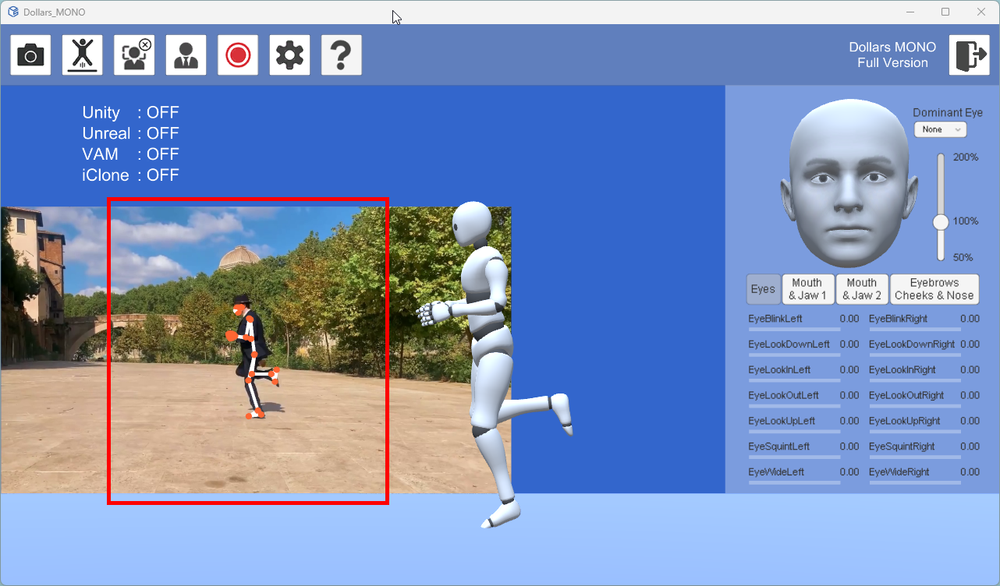

# 強化モード

:::warning 非推奨

MONO v.260828 以降、関連するオプションは削除されました。

このページは旧バージョンにのみ適用されます。

:::

Options ウィンドウで「Enhanced Mode」(強化モード)オプションにチェックを入れると、より高品質なモーションキャプチャを行うことができます。

強化モードでは、以下の点でパフォーマンスが向上します。

- 腰と足のトラッキングがより安定します。
- 全体的な動きの再現性が向上します。

強化モードを使用する際は、以下の点にご注意ください。

- **GPU 使用率の増加：** 強化モードでは、より多くの GPU リソースが必要になります。
- **複数の人物：** フレーム内に複数の人物がいる場合、強化モードでのトラッキングは干渉を受けやすくなることがあります。
- **横向きモードの制限：** 横向きモードでは、演者の動ける範囲が制限されます。理想的な範囲は、下図の赤い線で示されています。

- 
