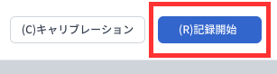
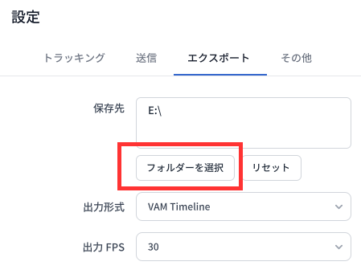

# ファイルのエクスポート

下図の **記録開始** ボタンをクリックするか **R** キーを押すと、モーションデータと表情データの記録を開始または停止できます。



## 出力形式

MONO は現在、以下の形式に対応しています。

1. FBX
2. BVH
3. BVH for Cascadeur
4. BVH for VAM
5. VAM Timeline

FBX ではモーションデータと表情データの両方をエクスポートできます。BVH でエクスポートできるのはモーションデータのみです。

### 形式の選び方

BVH を iClone または Cartoon Animator で使用する場合は、2 番目の形式を選択してください。

BVH を Cascadeur で使用する場合は、3 番目の形式を選択してください。

BVH を Virt-A-Mate で使用する場合は、4 番目の形式を選択してください。

それ以外の場合は、用途に応じて任意の形式を選択してください。

## ファイル名と保存先

モーションファイルは、`Dollars_` にタイムスタンプを付加したファイル名で保存されます。

表情ファイルは、`Dollars_BS_` にタイムスタンプを付加したファイル名で保存されます。

ファイルは、OS に応じて以下のディレクトリに保存されます。

- - Windows

```C:\Users\[Username]\AppData\LocalLow\SunnyView\Dollars_MONO\```

- macOS

```/Users/[Username]/Library/Application Support/com.SunnyView.Dollars-MONO```

**保存先** は **設定** で変更できます。



**リセット** ボタンをクリックすると、保存先を上記の既定ディレクトリに戻せます。

指定した保存先ディレクトリへの書き込み権限があることを確認してください。MONO が選択したディレクトリにファイルを保存できない場合は、上記の既定パスに自動的に保存されます。

:::info ご注意

保存先ディレクトリを変更した後は、テスト記録を行い、新しい保存先に書き込めることを確認してください。

:::
