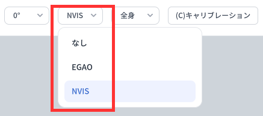

# フェイスキャプチャモジュール

v.241128 以降、MONO には EGAO と NVIS の 2 種類のフェイスキャプチャモジュールが搭載されています。設定で、用途に応じて使用するモジュールを選択できます。

:::warning

macOS 版の MONO は、現在 EGAO フェイスキャプチャモジュールのみに対応しています。

:::

## EGAO

EGAO は v.230708 から MONO に搭載されているフェイスキャプチャモジュールです。システム負荷が非常に低く、基本的なフェイスキャプチャを行えるため、軽量な用途に適しています。

## NVIS

NVIS モジュールでは、iPhone に近い品質のフェイスキャプチャを実現できます。
