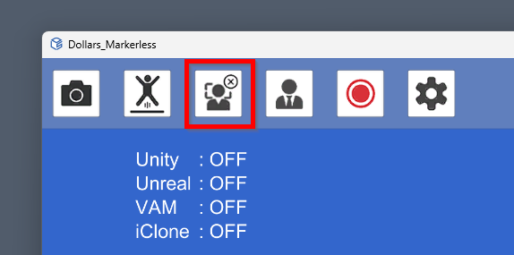
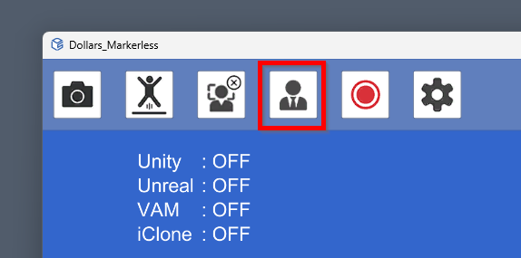
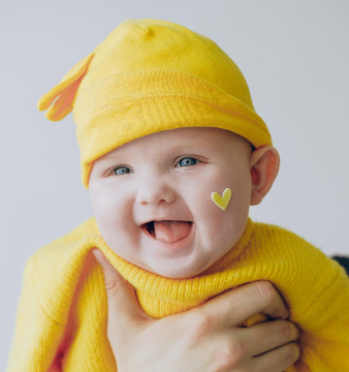
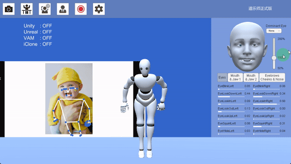
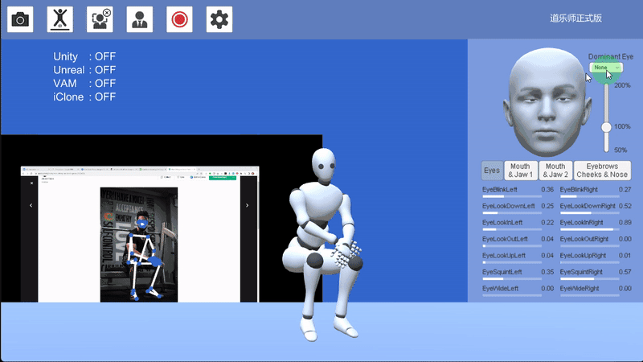
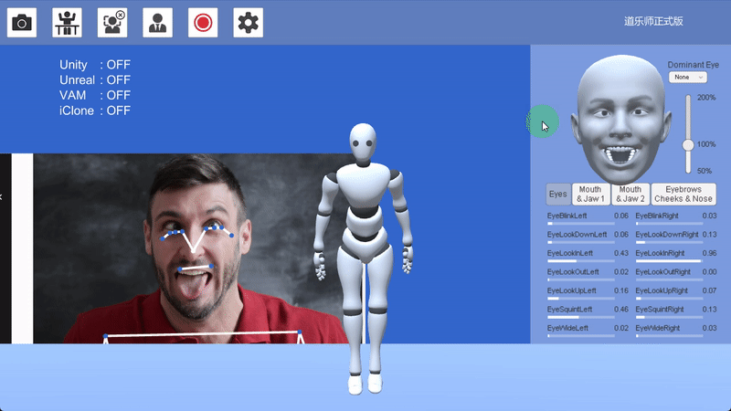

# フェイスキャプチャの設定

Dollars MONO は、ARKit 互換の表情キャプチャ機能を備えています。

下図のボタンで、フェイスキャプチャのオンとオフを切り替えられます。

**キャプチャ前の推奨事項:**

- 表情の力を抜いてください。
- 正面を向いてください。
- キャリブレーションを行ってください。

これらを行うことで、キャプチャ精度を高められます。

## 全体の強さ

右側の **全体の強さ** スライダーで、表情の強さを調整できます。

## 主眼
照明、カメラの角度、映像の鮮明さ、眼鏡の着用などの影響により、左右の視線がずれる場合があります。その場合は、**主眼** を設定すると左右の視線をそろえられます。

主眼を設定すると寄り目の表情は利用できなくなるため、ご注意ください。

