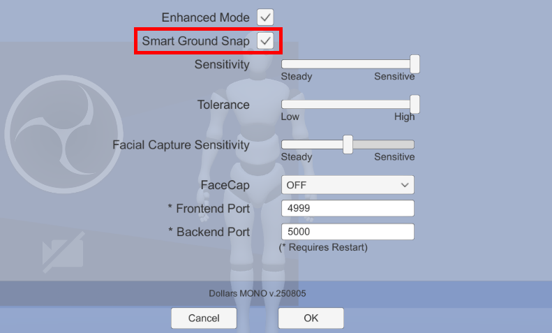
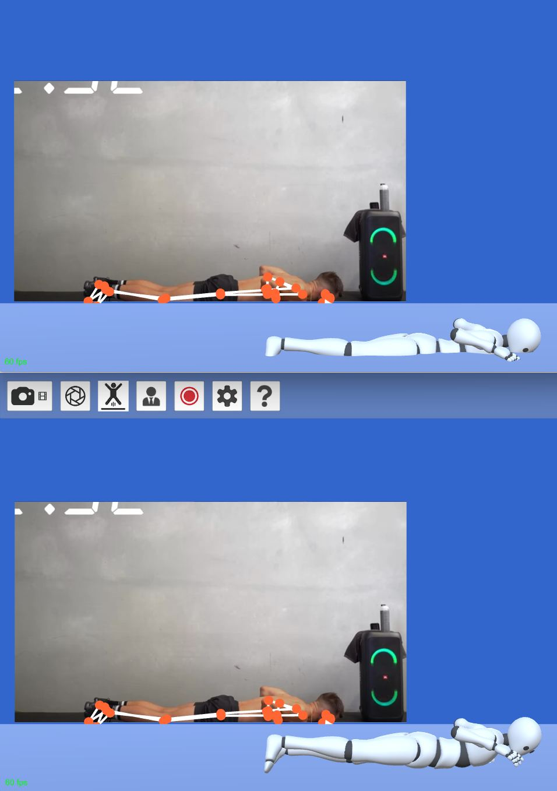

# スマート接地

:::warning 非推奨

MONO v.260828 以降、関連するオプションは削除されました。

このページは旧バージョンにのみ適用されます。

:::

スマート接地（Smart Ground Snap）機能は、必要に応じてキャラクターの垂直方向の位置を自動調整し、キャラクターが地面にめり込むのを防ぎます。

下図では、同じ入力に対する、この機能の有効化前後の違いを確認できます。

:::warning

場合によっては、この機能によりキャラクターの垂直方向の位置が変化に追従しにくくなったり、位置が急に飛んだりすることがあります。

このような問題が発生した場合は、機能を無効にして通常の動作に戻すことを推奨します。

:::
