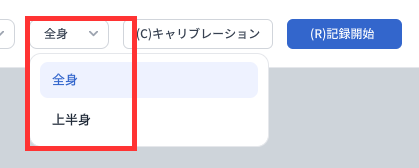

# モーションキャプチャモード

Dollars MONO には、**上半身** と **全身**の 2 種類のモーションキャプチャモードがあります。用途に応じて、下図のボタンで切り替えてください。

## 上半身モード

デスクでのライブ配信や録画など、上半身のみをキャプチャする用途に適しています。

## 全身モード

立った状態でのパフォーマンスやダンスなど、全身の動きをキャプチャする用途に適しています。
