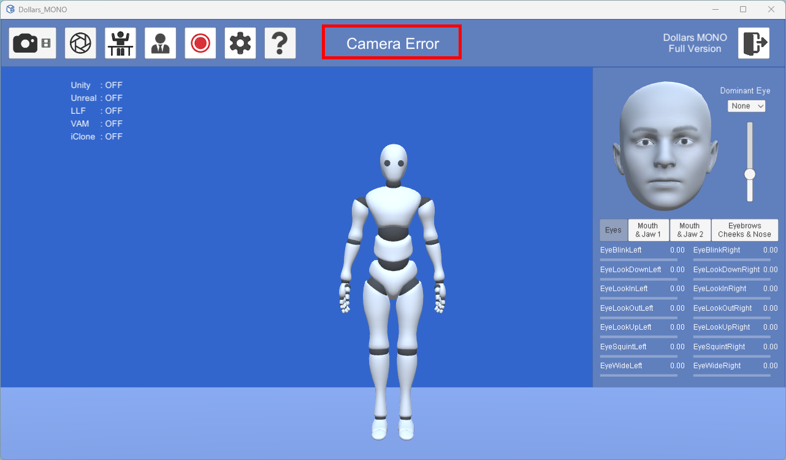

# エラーメッセージ

import TOCInline from '@theme/TOCInline';

<TOCInline toc={toc} />

MONO でエラーが発生すると、プログラム画面上部に該当するメッセージが表示されます。

MONO でよく表示されるエラーメッセージと対処方法を以下に示します。

## カメラエラー {#camera-error}

**考えられる原因:**

- プログラムにカメラへのアクセス許可がありません。
- カメラにハードウェアの問題があります。
- カメラが他のプログラムで使用されています。

**解決方法:**

- Windows の設定で、Dollars MONO にカメラへのアクセスが許可されていることを確認してください。
- Windows 標準のカメラアプリまたは OBS で、カメラが正常に動作するか確認してください。
- カメラを使用している可能性のある他のソフトウェアを終了してから、もう一度お試しください。
- 上記の方法で解決しない場合は、OBS でカメラを開き、**OBS Virtual Camera** 経由で映像を送信してみてください。詳しくは[仮想カメラを入力として使用する](/Dollars-MONO/virtualcam)を参照してください。

## 再生エラー

**考えられる原因:**

- 動画ファイルの形式がサポートされていないか、ファイルが破損しています。

**解決方法:**

- 対応している動画形式を使用してください（H.264 でエンコードされた MP4 を推奨します）。
- ファイルを再生できない場合は、動画ファイルを再エンコードしてください。

## DLL が見つからない

**考えられる原因:**

NVIS モジュールの使用に必要なライブラリファイルが、正しくインストールされていない可能性があります。

**解決方法:**

[フェイスキャプチャモジュール](/Dollars-MONO/facialcap-module)の手順に従って、必要な動的ライブラリファイルをダウンロードしてインストールしてください。
