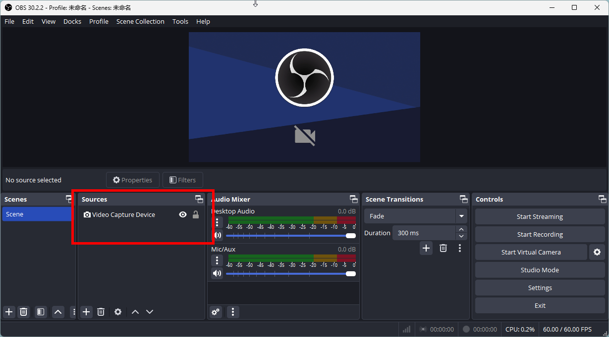
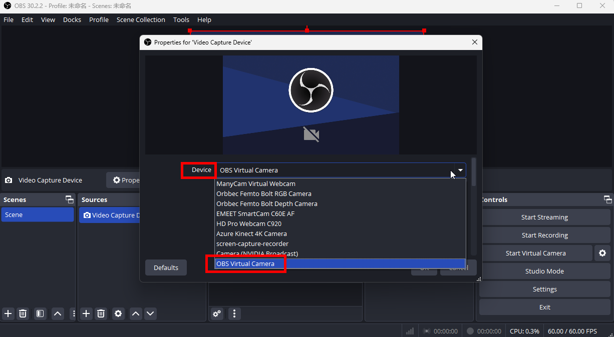
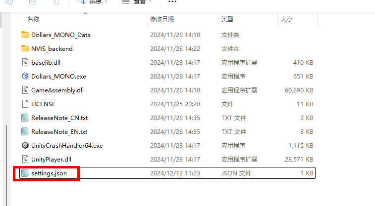
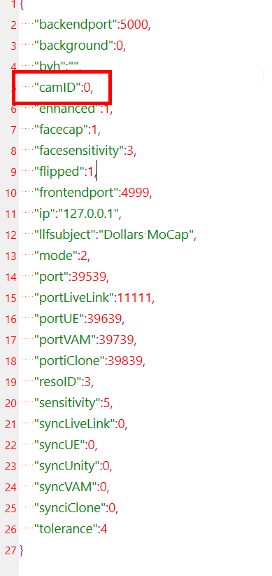

# よくある質問

import TOCInline from '@theme/TOCInline';

<TOCInline toc={toc} />

## 起動時にプログラムがクラッシュする

**原因 1: 必要な再頒布可能パッケージがインストールされていない**

**解決方法:**

1. 以下のページにアクセスし、最新の Visual C++ 再頒布可能パッケージをダウンロードしてください。

[Microsoft 公式ダウンロードページ](https://learn.microsoft.com/en-us/cpp/windows/latest-supported-vc-redist?view=msvc-170)

ダウンロード: [vc_redist.x64.exe](https://aka.ms/vs/17/release/vc_redist.x64.exe)

2. 再頒布可能パッケージをインストールしてコンピュータを再起動してから、もう一度 MONO を起動してください。

**原因 2: カメラの初期化に失敗している**

**解決方法:**
1. [公式サイト](https://obsproject.com) から最新版の OBS をダウンロードしてください。

2. OBS を開き、**映像キャプチャデバイス**を追加します。

3. **デバイス**の一覧で **OBS Virtual Camera** を探し、一覧での位置を確認します。

4. MONO のフォルダにある **settings.json** ファイルを開きます（このファイルが存在しない場合は、`C:\Users\{Your Username}\AppData\LocalLow\SunnyView\Dollars_MONO` にあります）。

5. **settings.json** 内の **camID** を、一覧における **OBS Virtual Camera** の位置から 1 を引いた値に変更します。

たとえば、**OBS Virtual Camera** が 3 番目にある場合は、**camID** を 2 に設定します。

6. MONO を起動し、正常に起動するか確認します。

この変更後に MONO が正常に起動する場合は、一覧内のいずれかのカメラがクラッシュの原因になっている可能性があります。カメラを 1 台ずつ試し、どのカメラでプログラムがクラッシュするかを確認してください。

原因となるカメラを特定できた場合は、MONO のカメラ一覧と該当するカメラを hi@sunnyview.tech までお知らせください。詳しく調査します。ご協力ありがとうございます。

:::danger 既知の問題

ShareX の **screen-capture-recorder** カメラを使用すると、MONO がクラッシュする場合があります。上記の手順で、このカメラが選択されないようにすることをお勧めします。

:::

## カメラが起動しない

[こちら](/Dollars-MONO/mono-errors#camera-error)をご確認ください。

## キャラクターが浮いている、または地面にめり込んでいる

カメラでリアルタイムキャプチャを行う場合は、開始前に[キャリブレーション](/Dollars-MONO/calibration)を行い、適切な[モーションキャプチャモード](/Dollars-MONO/mode)を選択してください。キャラクターが浮いたり地面に沈み込んだりする現象を抑えられます。

動画を使用したモーションキャプチャでこの問題が発生する場合は、外部プレーヤーで動画を再生し、その再生画面を OBS でキャプチャしてください。位置を調整してから、仮想カメラ経由で Dollars MONO に入力する方法をお試しください。

OBS の仮想カメラの使い方について詳しくは、[仮想カメラを入力として使用する](/Dollars-MONO/virtualcam)をご覧ください。

## 動画がカクつくなどの問題

動画の解像度やフレームレートを下げてみてください。

また、外部プレーヤーで動画を再生し、OBS の仮想カメラ経由で Dollars MONO に映像を送ることもできます。外部プレーヤーを使うと再生操作も行えます。

OBS の仮想カメラの使い方について詳しくは、[仮想カメラを入力として使用する](/Dollars-MONO/virtualcam)をご覧ください。

## スマートフォンのカメラを入力として使用する方法

スマートフォンのカメラを使用するには、まずスマートフォンの映像をコンピュータへ送信できるアプリケーションを用意してください。次に、OBS の仮想カメラを使用して、その映像を Dollars MONO に送ります。

OBS の仮想カメラの使い方について詳しくは、[仮想カメラを入力として使用する](/Dollars-MONO/virtualcam)をご覧ください。
