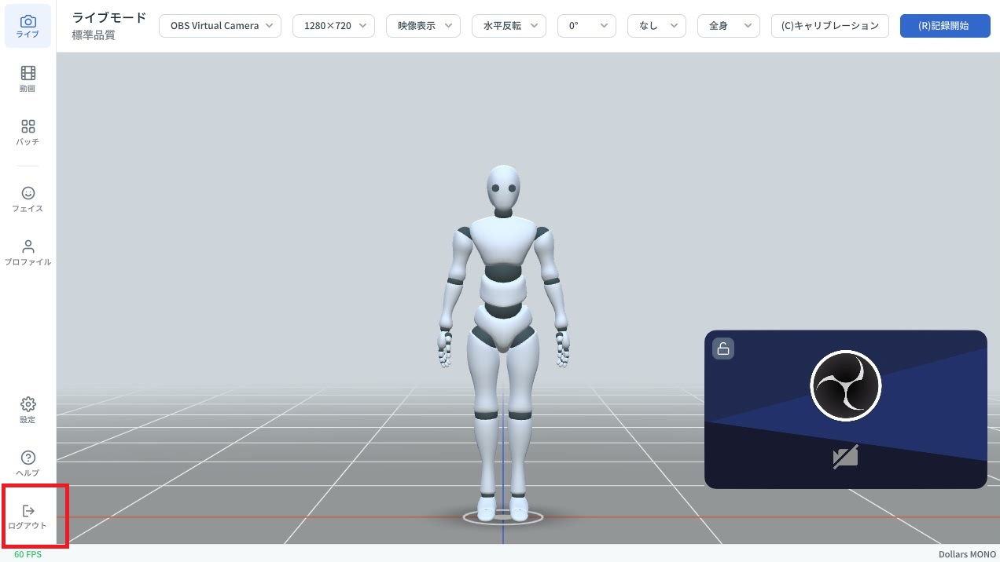
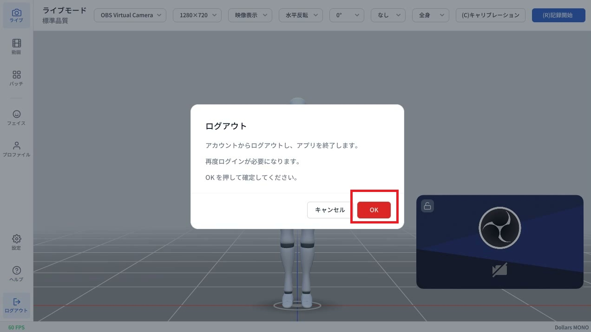

# NVIS モジュールの有効化

すでに MONO のライセンスをお持ちの場合、MONO はオフラインで動作するため、NVIS ライセンスを購入してもライセンス情報は自動では更新されません。

その場合は、MONO の画面左下にある **ログアウト** をクリックしてください。

表示されるダイアログでログアウトを確定します。

次回ログイン時に、MONO は最新の NVIS ライセンス情報を取得します。
