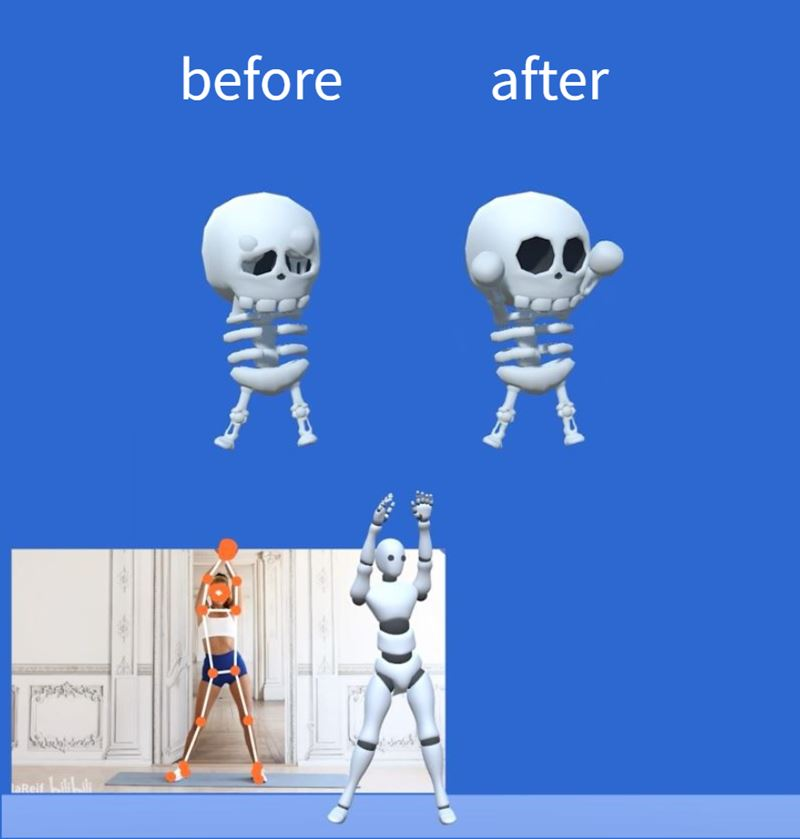
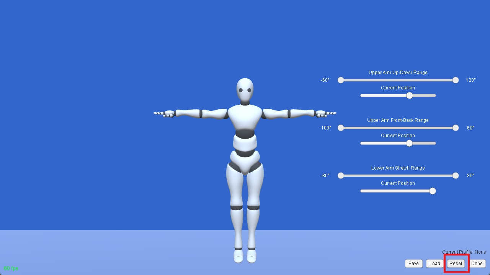

# モーションキャプチャプロファイルの設定

v.250707 以降、MONO はモーションキャプチャプロファイルの設定に対応しています。

プロファイルを設定すると、関節の可動範囲を制限して、キャプチャ中の身体パーツのめり込みを軽減できます（下図右側）。

Unity でキャラクターをレンダリングしている場合は、Unity に標準搭載されている Muscle Settings を使って同様の効果を得ることができます。

詳しくは、以下をご参照ください。

https://github.com/SunnyViewTech/MuscleSettings

:::warning ご注意

リアルタイムキャプチャ中のめり込みを完全に解消することは、現在も技術的に困難です。この機能は、めり込みの軽減を目的として提供されています。

:::

## 設定手順

:::warning ご注意

以下の手順の一部は、最新版の MONO と異なる場合があります。

:::

### 準備

1. モーションデータを正しく同期できるよう、キャラクターに Dollars プラグインが正しく設定されていることを確認してください。

2. MONO でストリーミングを有効にしてください。

3. プロファイル編集モードを開きます。

### 腕の上下範囲を設定する

アバターの頭や体が大きい場合、体の横に下ろした腕が頭や体にめり込みやすくなります。腕の上下の可動範囲を制限することで、この問題を軽減できます。

1. 右下の **Reset** ボタンをクリックして、アバターを T ポーズにします。

2. **Current Position** を左端まで動かし、**Upper Arm Up-Down Range** の最小値を調整します。

3. **Current Position** を右端まで動かし、**Upper Arm Up-Down Range** の最大値を調整します。

4. **Current Position** を左右に動かしてアバターの動きを確認し、意図した効果が得られているかを確認します。

<video controls width="50%">
  <source src="/ja/2025-09-23 19-37-54-638_1.mp4"/>
</video>

5. **Save** をクリックして設定を保存します。

### 腕の前後範囲を設定する

アバターの腕が長すぎる場合、腕が体の前で交差してしまうことがあります。腕の前後の可動範囲を制限することで、この問題を軽減できます。

1. 右下の **Reset** ボタンをクリックして、アバターを T ポーズにします。

2. **Upper Arm Front-Back Range** の上限と下限を調整します。

<video controls width="50%">
  <source src="/ja/2025-09-23 19-58-49-339_1.mp4"/>
</video>

3. 必要に応じて、**Upper Arm Up-Down Range** の上限と下限を調整します。

<video controls width="50%">
  <source src="/ja/2025-09-23 19-58-49-339_2.mp4"/>
</video>

4. **Lower Arm Stretch Range** の上限と下限を調整します。

<video controls width="50%">
  <source src="/ja/2025-09-23 19-58-49-339_3.mp4"/>
</video>

5. **Upper Arm Up-Down Range** と **Lower Arm Stretch Range** の可動範囲が同程度になるように調整します。

<video controls width="50%">
  <source src="/ja/2025-09-23 19-58-49-339_4.mp4"/>
</video>

6. それぞれの **Current Position** を調整し、結果を確認します。

<video controls width="50%">
  <source src="/ja/2025-09-23 19-58-49-339_5.mp4"/>
</video>

7. **Save** をクリックして設定を保存します。

## 複数のプロファイル

保存したプロファイルは、プログラムの起動時に自動的に読み込まれます。

また、キャラクターごとに個別のプロファイルを設定し、必要に応じて読み込むこともできます。
