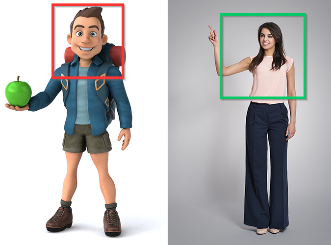
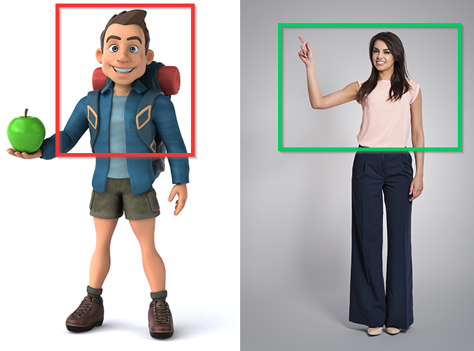
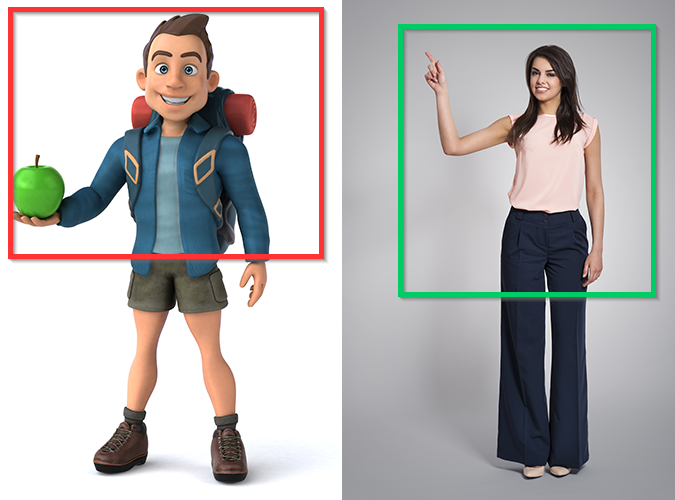
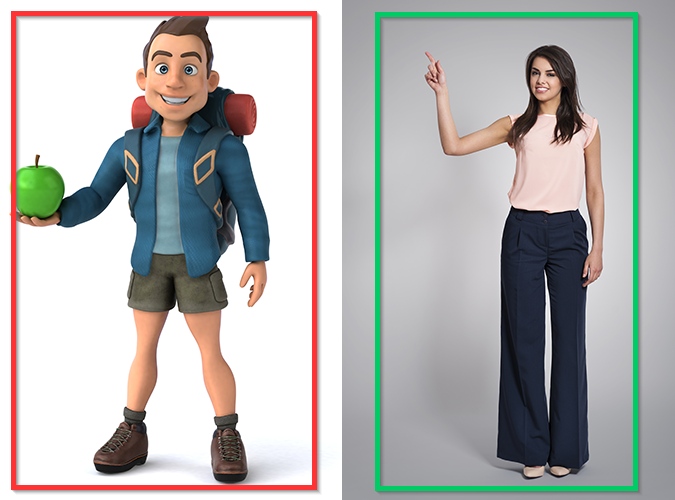
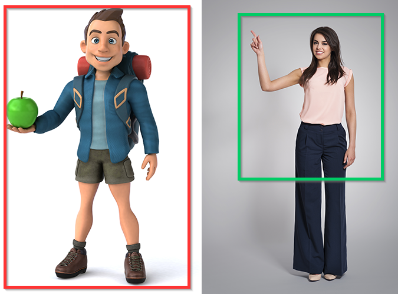

# はじめにお読みください

Dollars MONO をご利用になる前に、このページの内容を必ずお読みください。

## 撮影範囲に関する推奨事項

カメラ入力・動画入力を問わず、**演者の撮影範囲は、バーチャルキャラクターの表示範囲よりも広く確保してください**。

### 肩から上の表示

バーチャルキャラクターを肩から上だけ表示する場合は、演者を肘付近まで撮影してください。

### 肘から上の表示

バーチャルキャラクターを肘から上だけ表示する場合は、演者を手元まで撮影してください。

### 手全体の表示

バーチャルキャラクターの手全体を表示する場合は、演者を腰より下まで撮影し、腕を下ろしたときにも手がカメラのフレーム内に収まるようにしてください。

### 全身の表示

バーチャルキャラクターの全身を表示したい場合は、演者の全身もフレーム内に収める必要があります。

:::info[例外]

上半身モードでバーチャルキャラクターの全身を表示する場合、演者の全身をフレームに収める必要はありません。腰より下まで撮影してください。

:::

## モーションキャプチャ前のキャリブレーション

モーションキャプチャの前に適切なキャリブレーションを行うことで、動きや表情をより正確にキャプチャできます。

:::info

キャリブレーション中は、体と表情の力を抜き、両手を自然に体の横に下ろして、まっすぐ前を見てください。

:::

画像提供：Freepik

[Image by gpointstudio](https://www.freepik.com/free-photo/fashionable-smiling-woman-showing-empty-copy-space_11342232.htm#page=3&query=short%20tall&position=38&from_view=search&track=ais) 

[Image by julos](https://www.freepik.com/free-photo/fun-illustration-3d-cartoon-backpacker_13789537.htm#page=3&query=character%20full%20body&position=10&from_view=search&track=ais)
