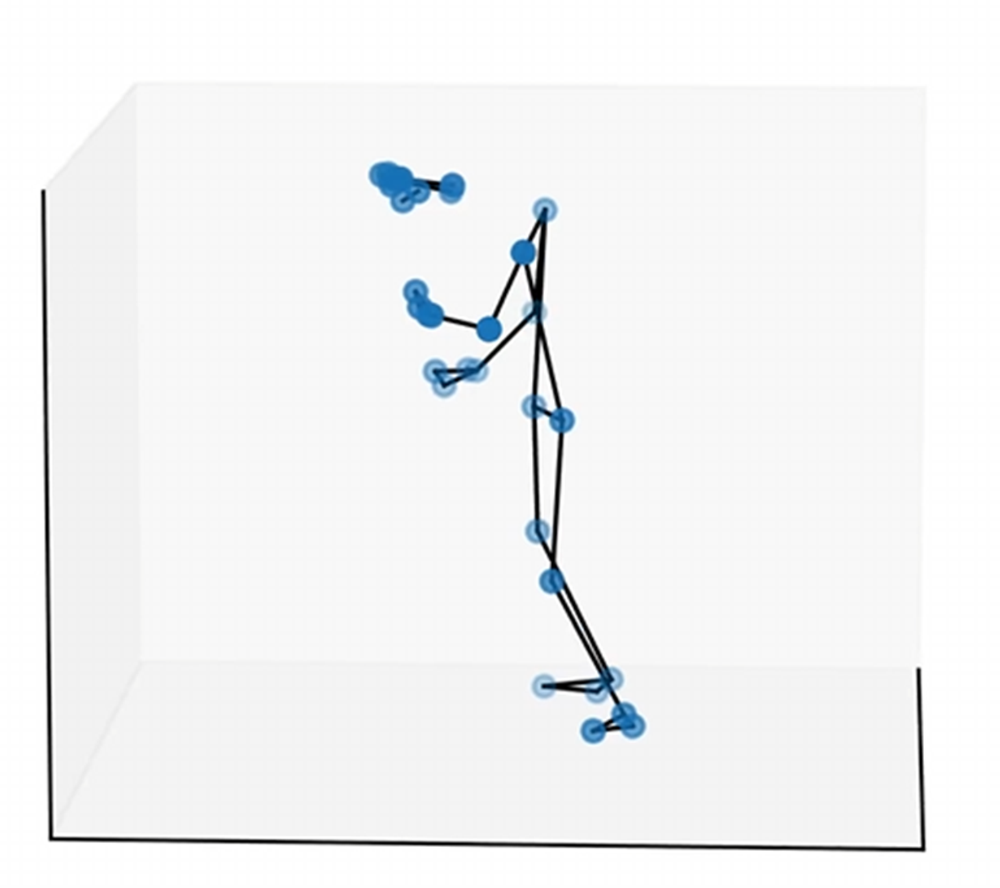
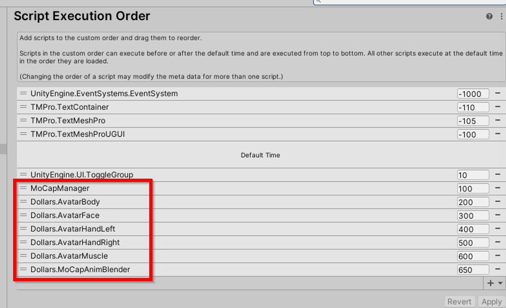
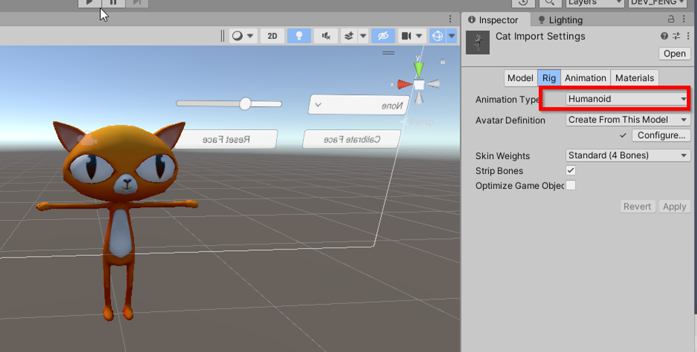
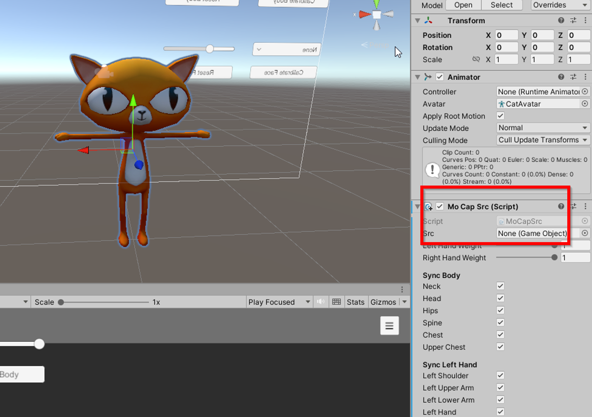
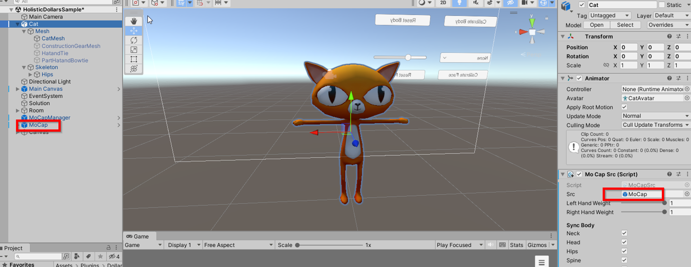
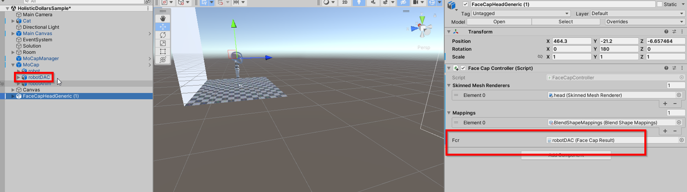
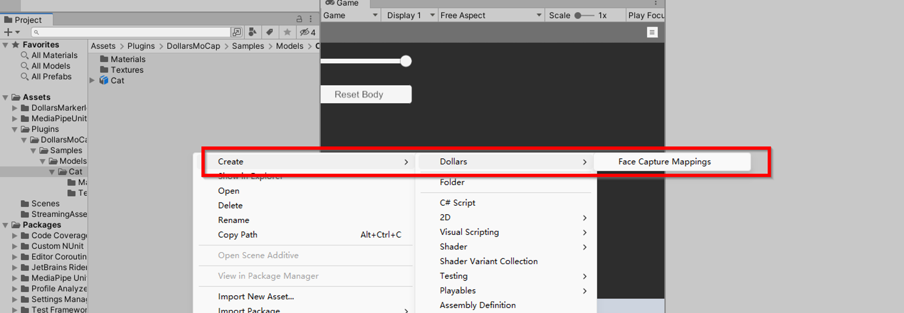
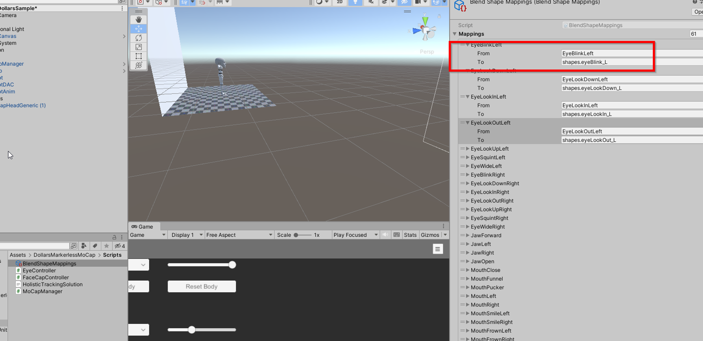
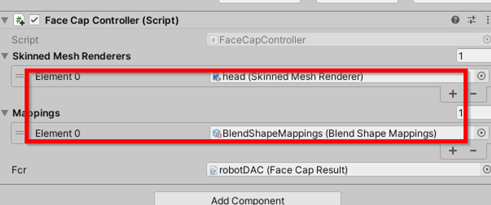

# MONO SDK ガイド

## はじめに

この SDK は [MediaPipeUnityPlugin](https://github.com/homuler/MediaPipeUnityPlugin) をベースとしており、WebGL 以外の Unity プラットフォームで動作します。

## データ型

### Dollars.MoCapMode

モーションキャプチャのモードを表します。

型: 列挙型
値: jump, flat, upperbody

### Dollars.DominantEye

フェイスキャプチャで使用する利き目を表します。

型: 列挙型
値: none, left, right

### Sensitivity

モーションキャプチャの感度を表します。

型: 整数
値: 1〜5。1 が最も安定し、5 が最も敏感です

### Strength

フェイスキャプチャの強度を表します。

型: 浮動小数点数
値: 制限はありませんが、0.5〜2 の範囲を推奨します。デフォルトは 1 です

## クラス

### AvatarBody

骨格データの計算に使用します。

#### InitFilter(int sensitivity)

#### SetMoCapMode(Dollars.MoCapMode mode)

#### SetSensitivity(int sensitivity)

#### Calibrate()

説明:

MediaPipe の現在の出力をもとに、アバターが両足を地面につけて直立するように調整します。

MediaPipe が出力する人体モデルは前傾することがあります（下図参照）。傾きの程度は、カメラのパラメータや人物の大きさなどによって異なります。

そのため、より良いモーションキャプチャ結果を得るには、開始前にキャリブレーションを行うことを推奨します。

キャリブレーション中は、リラックスして正面を向いてください。

#### ResetCalibration()

説明:

キャリブレーションデータをリセットします。カメラや動画ファイルを切り替える際に呼び出すことを推奨します。

### AvatarFace

フェイスキャプチャデータの取得に使用します。

#### Calibrate()

説明:

現在のフェイスキャプチャにおける表情パラメータを基準値として使用します。

#### ResetCalibration()

説明:

フェイスキャプチャのキャリブレーションデータをリセットします。
`AvatarBody.ResetCalibration()` と同時に呼び出すことを推奨します。

#### SetStrength(float strength)

説明:

フェイスキャプチャの強度を設定します。

#### SetDominantEye(Dollars.DominantEye eye)

説明:

フェイスキャプチャで使用する利き目を設定します。

## 使い方

### 実行順序

モーションキャプチャを開始する前に、以下の関数を呼び出してください。

`AvatarBody.InitFilter(5);`

`AvatarBody.SetMoCapMode(MoCapMode.jump);`

これによりフィルターが初期化され、モーションキャプチャモードが設定されます。呼び出し順序は変更できません。

サンプルプロジェクトの MoCapManager.cs を参考にしてください。

また、実行順序を設定し、MoCapManager.cs がモーションキャプチャ関連の他のコードより先に実行されるようにしてください。

モーションキャプチャ関連のコードは、上のスクリーンショットに示す順序を維持してください。

### アバターにモーションキャプチャを追加する

モデルの Rig を Humanoid に設定し、すべてのボーンが正しく割り当てられていることを確認します。

モデルをシーンに追加し、MoCapSrc コンポーネントをアタッチします。

モデルが T ポーズになっていない場合は、ボーンの角度を調整してモデルを T ポーズにします。

MoCapSrc コンポーネントの `src` 変数に、シーン内の MoCap オブジェクトを設定します。

これで完了です。

### アバターにフェイスキャプチャを追加する

アバターに Face Cap Controller コンポーネントを追加し、その `Fcr` 変数にシーン内の MoCap 配下にある `robotDAC` を設定します。

Face Capture Mapping ファイルを作成します。

Mapping ファイルの `To` 列に、各フェイスキャプチャの表情に対応するブレンドシェイプ名を入力します。大文字と小文字は区別されます。

Face Capture Controller の **Skinned Mesh Renderers** 配列に、ブレンドシェイプを持つアバターのメッシュを設定します。

**Mappings** 配列に、マッピングファイルを設定します。

注意事項:

- 特定のフェイスキャプチャの表情に対応するブレンドシェイプがない場合は、マッピングファイルの該当する箇所を空欄のままにしてください。
- Mapping ファイルの `TongueOut` 列以降は無視してかまいません。
- 1 つのフェイスキャプチャの表情で複数のブレンドシェイプを制御する場合は、**Skinned Mesh Renderers** 配列に同じメッシュを複数回追加し、それぞれに異なるマッピングを割り当てることができます。
- **Skinned Mesh Renderers** 配列と **Mappings** 配列は、要素数と順序を一致させる必要があります。
