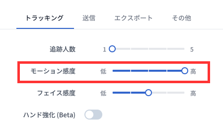

# モーション感度

用途に応じて **モーション感度** を調整することで、さまざまな効果を得ることができます。

以下の動画では、感度の違いがモーションキャプチャの結果にどのような影響を与えるかを紹介しています。

<iframe width="640" height="360" src="https://www.youtube.com/embed/QUW-s6oyzuQ?si=fP2bZiz83OFg4IsC" title="YouTube video player" frameborder="0" allow="accelerometer; autoplay; clipboard-write; encrypted-media; gyroscope; picture-in-picture; web-share" allowfullscreen></iframe>
