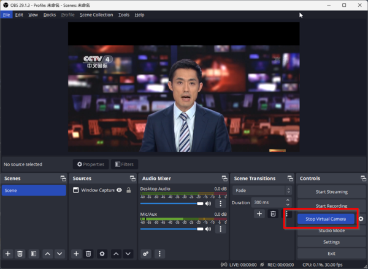
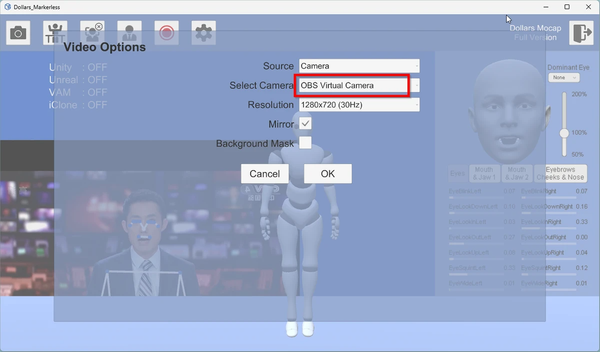
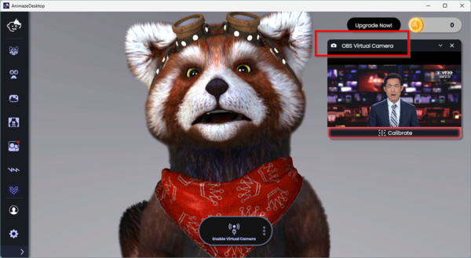

# 複数のアプリケーションでカメラを共有する

このセクションでは、OBS の仮想カメラを使って、1 台のカメラを複数のアプリケーションで共有する方法をご紹介します。これにより、Dollars MONO でモーションキャプチャを行いながら、Animaze や VSeeFace などの VTuber ソフトウェアで同時に表情をキャプチャできます。

OBS は [公式サイト](https://obsproject.com) からダウンロードできます。

## カメラを共有する手順

1. **OBS にソースを追加する:** OBS にデスクトップウィンドウまたは映像キャプチャデバイスを追加し、右側のボタンをクリックして仮想カメラを開始します。

2. **Dollars MONO で設定する:** 映像ソースとして **OBS Virtual Camera** を選択します。

3. **Animaze で設定する:** Animaze でも、入力ソースとして **OBS Virtual Camera** を選択します。

これで、1 台のカメラを使いながら、Dollars MONO ではモーションキャプチャを、Animaze では表情キャプチャを同時に行えます。
