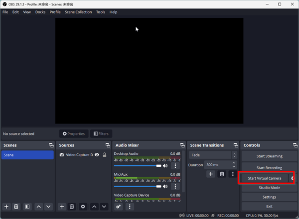
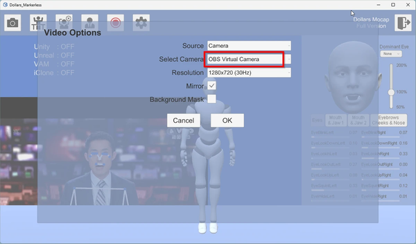
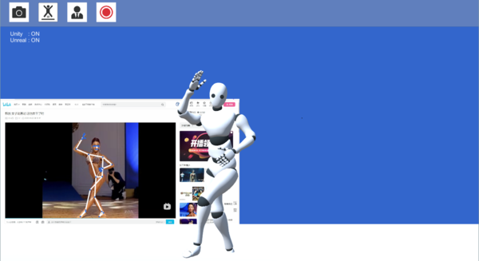
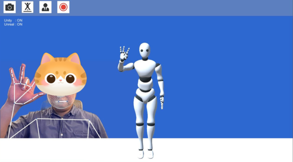

# 仮想カメラを入力として使用する

v.230722 以降、Dollars MONO は OBS の仮想カメラに対応しています。仮想カメラを使用すると、次のようなことができます。

- **カメラの縦置き:** Web カメラを縦向きに設置し、全身を撮影しやすくします。
- **スマートフォンを映像ソースにする:** スマートフォンの映像を入力にして、フェイスキャプチャとモーションキャプチャを行います。
- **デスクトップウィンドウのキャプチャ:** デスクトップ上のウィンドウを入力として、モーションを直接キャプチャします。

OBS は [公式サイト](https://obsproject.com/) からダウンロードできます。

## OBS の仮想カメラを使用する

1. OBS で、画面右側のボタンをクリックして仮想カメラを開始します。

2. Dollars MONO で、映像ソースとして OBS の仮想カメラを選択します。

OBS のウィンドウキャプチャ機能を使うと、画面上の別のウィンドウをキャプチャし、モーションキャプチャの入力として使用できます。

また、スマートフォンの画面をコンピュータにミラーリングし、Live Link Face などのアプリと組み合わせて、フェイスキャプチャとモーションキャプチャを行うこともできます。

以下の動画では、OBS の仮想カメラを活用してモーションキャプチャを行う方法を紹介しています。

<iframe width="640" height="360" src="https://www.youtube.com/embed/SVX8jBEmwBU" title="YouTube video player" frameborder="0" allow="accelerometer; autoplay; clipboard-write; encrypted-media; gyroscope; picture-in-picture; web-share" allowfullscreen></iframe>
