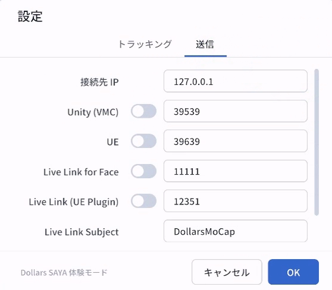

# はじめに

## デバイスの設置

最適なトラッキング結果を得るために、使用シーンに合わせてデバイスを設置してください。デバイスはできるだけ垂直に保ち、前後に傾かないようにしてください。

### 上半身トラッキング

- **設置位置**  
  デバイスを体の正面に置き、できるだけ顔の高さに合わせてください。

- **撮影範囲**  
  両手を下ろしているとき（手を自然に下げているときや、マウス・キーボードを操作しているときなど）は、手がカメラの画角に入らないようにしてください。  
  一方、両手を上げたときは、両手全体が画角に収まるようにしてください。

  スペースに余裕がある場合は、少し後ろに下がることで、より広い範囲をトラッキングできます。

### 全身トラッキング

- **設置位置**  
  デバイスを体の真正面に置き、腰くらいの高さに調整してください。また、体から十分な距離を確保してください。

- **撮影範囲**  
  頭から足先まで全身が画面内に収まるようにしてください。動いている間も足が画面から外れないよう、十分なスペースを確保してください。

### デバイスの向き

SAYA はデフォルトで左向きの横画面で起動します。別の向きでトラッキングする場合は、コントロールセンターで画面の回転ロックを解除し、デバイスを希望の向きに回転させてください。

## 撮影環境

### 照明

顔、手、体の輪郭をはっきりと認識できるよう、明るく均一な照明のもとで撮影してください。強い逆光や暗すぎる環境、明るさが頻繁に変化する環境は、認識精度の低下につながるため避けてください。

### 背景

できるだけシンプルで整理された背景を選んでください。体の動きに似た形状の物体や、動いている人物が背景に映り込まないようにしてください。

また、体と背景の色に十分な違いを持たせることで、体や手のキーポイントをより正確に認識しやすくなります。

### 服装

背景と色がはっきり区別できる服を着用してください。上着やズボンが背景と似た色にならないようにしてください。

また、体の輪郭が隠れるほどゆったりした服や、光を強く反射する素材の服は避けてください。

## PC への接続

デバイスの設置が完了したら、以下の手順で PC と接続してください。

1. Dollars SAYA アプリを起動し、メイン画面から設定ページを開きます。
2. 「接続先 IP」欄に、PC のローカル IP アドレスを入力します。
3. 入力内容を確認し、「保存」をタップします。

> **ヒント**  
> USB で PC に接続すると、デバイスに新しい IP アドレスが割り当てられる場合があります。その場合は、設定ページで接続先 IP アドレスを更新してください。

## PC ソフトウェアへのデータ送信

Dollars SAYA は、トラッキングデータを PC 上のアプリケーションや VTuber ソフトウェアにリアルタイムで送信できます。

SAYA の設定ページで使用するプロトコルのスイッチをオンにすると、対応するソフトウェアへのデータ送信が開始されます。

- **VMC**：VTuber ソフトウェアや Unity など、VMC に対応したアプリケーションとの連携に使用します。
- **UE**：Dollars MoCap の OSC プラグインを使用して Unreal Engine のキャラクターを動かす際に使用します。
- **Live Link for Face**：Unreal Engine でリアルタイムのフェイストラッキングを行う際に使用します。
- **Live Link（UE Plugin）**：Dollars MoCap の Live Link プラグインを使用して Unreal Engine のキャラクターを動かす際に使用します。

## 使用上のヒント

### デバイスのパフォーマンス最適化

**ネットワークの安定性を高める**  
Wi-Fi 接続時に遅延が大きい場合や接続が不安定な場合は、有線 LAN アダプター（Lightning / USB-C to RJ45）を使用して、デバイスをルーターに直接接続することをお勧めします。  
有線接続により、Wi-Fi の通信状況による影響を抑え、遅延や接続の不安定さを軽減できます。

**USB 接続**  
USB ケーブルを使用して PC に直接接続することもできます。  
この場合、着信や通知による配信・録画の中断を防ぐため、機内モードを有効にすることをお勧めします。

**デバイスの温度管理**  
長時間使用すると、デバイスの温度が上昇する場合があります。発熱を抑えるための最適化を行っていますが、長時間の配信や録画では温度が高くなることがあります。

以下の対策をお勧めします。

- 小型ファンなどの冷却機器を使用する。
- 長時間の配信前に、予定している配信時間よりも長くテストを行い、デバイスの温度変化を確認する。
