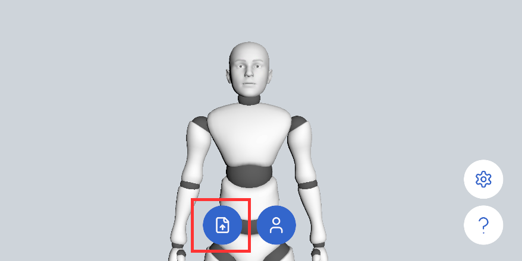

# VRM の読み込み

## VRM を読み込むメリット

SAYA はデフォルトで、内蔵の Dollars MoCap モデルの体型に基づいてモーションを計算します。使用するキャラクターの肩幅や腕の長さなどが内蔵モデルと大きく異なる場合、動きにずれが生じることがあります。

例えば、合掌のように両手の位置を正確に合わせる必要がある動作では、両手がうまく合わなかったり、手が互いにめり込んだりすることがあります。

また、キャラクターの腰の高さが内蔵モデルと大きく異なる場合、足の位置にずれが生じ、足が床にめり込んだり、床から浮いたりすることがあります。

VRM モデルを読み込むと、SAYA はそのモデルのボーン構造や比率に合わせてモーションを計算します。これにより、キャラクターの体型に合った動きを実現し、両手の位置のずれやめり込み、足の位置のずれなどを軽減できます。

## 読み込み手順

1. キャラクターの VRM ファイルをデバイスに転送します。AirDrop、クラウドストレージ、USB ケーブルなどを利用できます。
2. SAYA 画面下部のボタンをタップし、表示されたダイアログから VRM ファイルを選択します。

読み込んだ VRM モデルは、SAYA を起動するたびに自動的に読み込まれます。

:::info ご注意

VRM の読み込みが影響するのは、Unity（VMC）プロトコルの出力のみです。他のプロトコルの出力には影響しません。

:::
