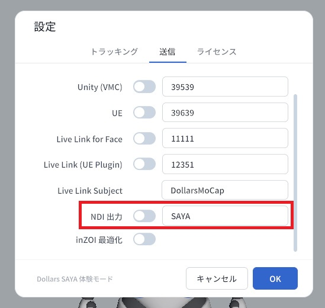
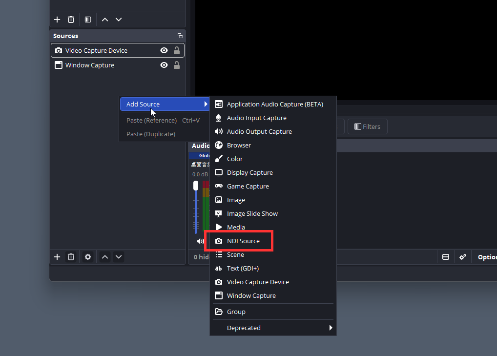

# NDI 出力

SAYA は、レンダリング済みのアバター映像を NDI 経由で同一ローカルネットワーク内のコンピュータに送信し、OBS の映像ソースとして直接使用できます。アバターのレンダリングはデバイス上で行われるため、コンピュータ側でアバター表示用のソフトウェアを実行する必要がありません。その分、配信や録画など、他の作業にコンピュータのリソースを活用できます。

## 使用前の準備

まず、[VRM の読み込み](./loadvrm.md) を参照してアバターを読み込んでください。また、デバイスとコンピュータが同じローカルネットワークに接続されていることを確認してください。

## NDI 出力を有効にする

SAYA の設定画面で、NDI 出力のスイッチをオンにします。スイッチの横にある入力欄では、NDI ソース名を設定できます。デフォルトの名前は「SAYA」です。必要に応じて変更してください。

## OBS で受信する

初めて使用する場合は、PC に OBS 用の NDI プラグイン「DistroAV」（旧 obs-ndi）と、必要な NDI ランタイムをインストールしてから、OBS を再起動してください。

OBS でソースを追加し、「NDI Source」を選択します。

ソース一覧から使用するデバイスを選択してください。ソース名は通常、デバイスの機種名にランダムな 4 文字の英字を組み合わせた形式で表示されます。括弧内には、SAYA の設定で指定した NDI ソース名が表示されます。

選択すると、アバターの映像がリアルタイムで表示されます。

:::info ご注意

NDI 出力を有効にしてから、ソースが OBS に表示されるまで 30 秒から 1 分ほどかかる場合があります。

しばらく待っても表示されない場合は、デバイスとコンピュータが同じローカルネットワークに接続されていることを確認してください。また、コンピュータのファイアウォールによって NDI の通信がブロックされていないか確認してください。

:::

## VMC との遅延比較

以下の動画では、NDI 出力と VMC 送信の映像遅延を比較しています。VMC ではコンピュータ側のソフトウェアでアバターをレンダリングします。接続方法を選ぶ際の参考にしてください。

なお、動画内の NDI 出力には、OBS の「NDI Source」のデフォルト設定を使用しています。

<iframe width="640" height="360" src="https://www.youtube.com/embed/JEidb1GrR6A" title="YouTube video player" frameborder="0" allow="accelerometer; autoplay; clipboard-write; encrypted-media; gyroscope; picture-in-picture; web-share" allowfullscreen></iframe>
