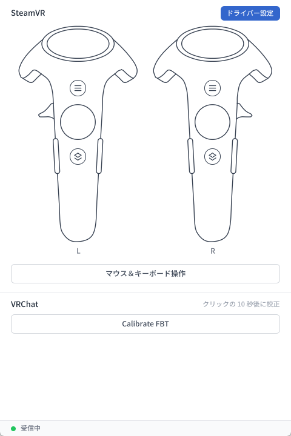
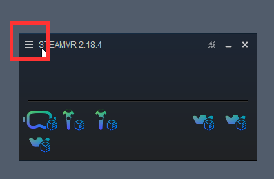
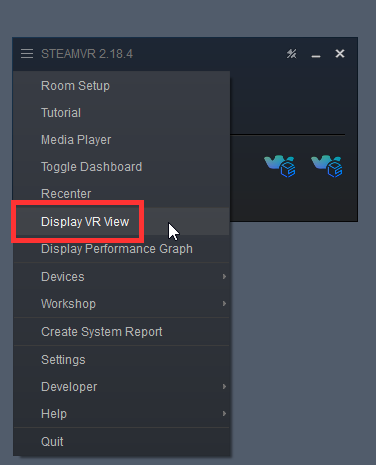

# コントローラーとマウス＆キーボード操作

## コントローラーのボタン

Bridge のメイン画面上部には 2 つのコントローラーが表示されます。左側の L が左手、右側の R が右手に対応します。コントローラー画像上のボタンをマウスで押し続けると、対応するコントローラーのボタンを押した状態をシミュレートできます。マウスを離すと、ボタンも離されます。

- 操作できるボタンは、メニューボタン、システムボタン、トリガー、トラックパッド、グリップボタンです。
- トラックパッドでは、押した位置がトラックパッド上の指の位置に対応します。押したままマウスをドラッグすると、その位置を移動できます。
- 押されているボタンは青色で表示されます。

## ボタン入力の確認

SteamVR の VR View では、仮想コントローラーとボタン操作の効果を確認できます。

1. SteamVR ウィンドウ左上の ☰ メニューボタンをクリックします。

   

2. **Display VR View** にチェックを入れます。

   

VR View ウィンドウに仮想コントローラーが表示されます。Bridge でボタンを押すと、対応する効果をここで確認できます。

### トリガー

<video controls width="100%">
  <source src="/ja/steamvr-trigger.mp4"/>
</video>

### トラックパッド

<video controls width="100%">
  <source src="/ja/steamvr-trackpad.mp4"/>
</video>

### システムボタン

<video controls width="100%">
  <source src="/ja/steamvr-system-button.mp4"/>
</video>

## マウス＆キーボード操作

操作を簡単にするため、Bridge にはマウス＆キーボード操作が用意されています。メイン画面の **マウス＆キーボード操作** をクリックすると、マウスとキーボードでヘッドセットとコントローラーを直接操作できます。

| 操作 | 説明 |
| --- | --- |
| マウスを動かす | 視点を動かします。 |
| 左クリック | トリガーを押します。 |
| Esc | マウス＆キーボード操作を終了します。ヘッドセットと両手はモーションキャプチャによる操作に戻ります。 |
