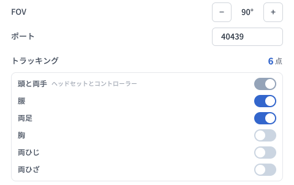
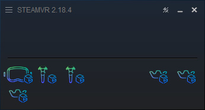
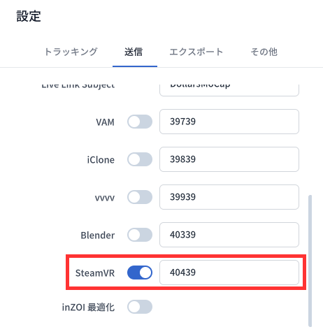
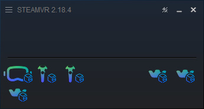

# SteamVR

:::info ご注意
Dollars MONO と Dollars SAYA は v.261110 以降で対応しています。

以下のドライバーのインストール手順は、実機のヘッドセットがインストールされていない場合を想定しています。すでに実機のヘッドセットをお使いの場合は、2 つの VR システムを併用する方法について SteamVR のドキュメントを参照してください。
:::

ご使用の前に、Steam から SteamVR をインストールし、[Dollars MoCap 公式サイト](https://www.dollarsmocap.com/download#plugins)から **Dollars MoCap SteamVR Plugin**（プログラム名は DollarsMoCapSteamVRBridge、以下 Bridge）をダウンロードしてください。

## ドライバーのインストール

1. Bridge のフォルダーを固定の場所に置いてください。ドライバーは Bridge のあるフォルダーから読み込まれるため、インストール後にフォルダーを移動した場合は、ドライバーを再インストールする必要があります。
2. SteamVR を終了します。
3. Bridge を開き、右上の **ドライバー設定** をクリックします。
4. 必要に応じて設定を変更し、**インストール** をクリックします。

| 設定 | 説明 |
| --- | --- |
| FOV | 仮想ヘッドセットの垂直視野角です。デフォルトは 90° です。 |
| ポート | モーションキャプチャデータの受信に使用するポートです。デフォルトは 40439 で、MONO または SAYA の SteamVR のポートと一致させる必要があります。 |
| トラッキング | 頭と両手は常に有効で、その他の部位は必要に応じて選択できます。デフォルトでは 6 点トラッキング（頭、両手、腰、両足）が有効です。まずはこの構成から始め、慣れてから徐々にトラッキングポイントを増やすことをおすすめします。右側にはトラッキングポイントの合計数が表示されます。 |

インストール後に SteamVR を起動すると、SteamVR ウィンドウに Dollars MoCap の仮想ヘッドセットとトラッカーのアイコンが表示されます。この時点ではまだモーションキャプチャデータを受信していないため、アイコンは輪郭のみ表示されます。

## Dollars MoCap 側の設定

設定の **送信** タブで SteamVR を有効にし、ポートが Bridge のドライバー設定のポート（デフォルトは 40439）と一致していることを確認してください。

送信を開始すると、SteamVR ウィンドウのヘッドセット、コントローラー、トラッカーのアイコンが塗りつぶし表示に変わり、モーションキャプチャデータを受信していることを示します。

- Dollars MoCap と SteamVR を別々のコンピュータで実行する場合は、Dollars MoCap の送信先 IP を、SteamVR を実行しているコンピュータの IP アドレスに設定してください。Bridge は SteamVR と同じコンピュータで実行する必要があります。
- Bridge がモーションキャプチャデータを受信すると、ウィンドウ下部に **受信中** と表示されます。
- SteamVR には常に実際の左右の手のデータが送信され、ミラー設定の影響を受けません。

## アンインストール

SteamVR を終了してから、ドライバー設定ページで **アンインストール** をクリックします。Bridge は、このドライバーの登録情報と、このドライバーが書き込んだルーム設定およびトラッカー設定を削除します。その他のドライバーや設定には影響しません。
