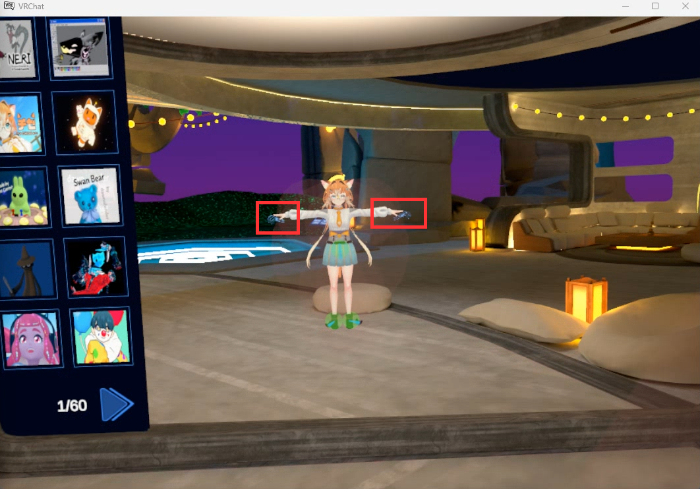
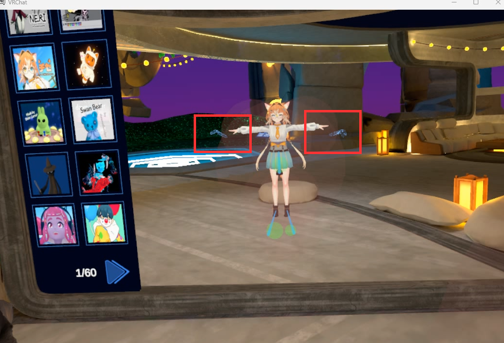

# フルボディキャリブレーション

## 初回設定

初めてキャリブレーションする前に、メインメニューの **Tracking & IK** 設定で **User Real Height** を 5' 11"（1.80 m）に設定してください。これは Dollars MoCap 内の Avatar の身長で、この値に合わせることで、VRChat の Avatar が動きをより正確に再現できるようになります。

この設定は一度だけ行えば十分です。以降のキャリブレーションで再度設定する必要はありません。

<video controls width="100%">
  <source src="/ja/vrchat-fbt-real-height.mp4"/>
</video>

## キャリブレーション手順

1. Dollars MoCap 製品でモーションキャプチャのキャリブレーションを完了します。
2. Bridge で **マウス＆キーボード操作** をクリックし、Q を押してクイックメニューを開いてから、VRChat のクイックメニューで **Calibrate** をクリックします。
3. Esc を押してマウス＆キーボード操作を終了すると、頭と両手はモーションキャプチャによる操作に戻ります。続いて Bridge で **Calibrate FBT** をクリックし、10 秒のカウントダウン中にまっすぐ立って、両腕を横に水平に伸ばしてください。
4. カウントダウンが終わると、Bridge が左右のコントローラーのトリガーを自動的に同時に引き、VRChat のフルボディキャリブレーションが完了します。

### 1. Dollars MoCap でのキャリブレーション（MONO の例）

<video controls width="100%">
  <source src="/ja/vrchat-fbt-mocap-calibration.mp4"/>
</video>

### 2. クイックメニューを開いて Calibrate をクリック

<video controls width="100%">
  <source src="/ja/vrchat-fbt-calibrate.mp4"/>
</video>

### 3. Calibrate FBT をクリックして両腕を伸ばす

<video controls width="100%">
  <source src="/ja/vrchat-fbt-countdown.mp4"/>
</video>

### 4. フルボディキャリブレーションの完了

<video controls width="100%">
  <source src="/ja/vrchat-fbt-done.mp4"/>
</video>

## 腕の比率の調整

キャリブレーション中、VRChat に表示される VR コントローラーは、Avatar の手の位置とほぼ重なっている必要があります。

コントローラーが Avatar の手より明らかに外側にある場合は、

メインメニューの **Tracking & IK** 設定で **Arm vs Height Ratio** を大きくしてから、

<video controls width="100%">
  <source src="/ja/vrchat-fbt-arm-ratio.mp4"/>
</video>

もう一度キャリブレーションしてください。

逆に、コントローラーが Avatar の腕の内側にある場合は、**Arm vs Height Ratio** を少し小さくしてください。
