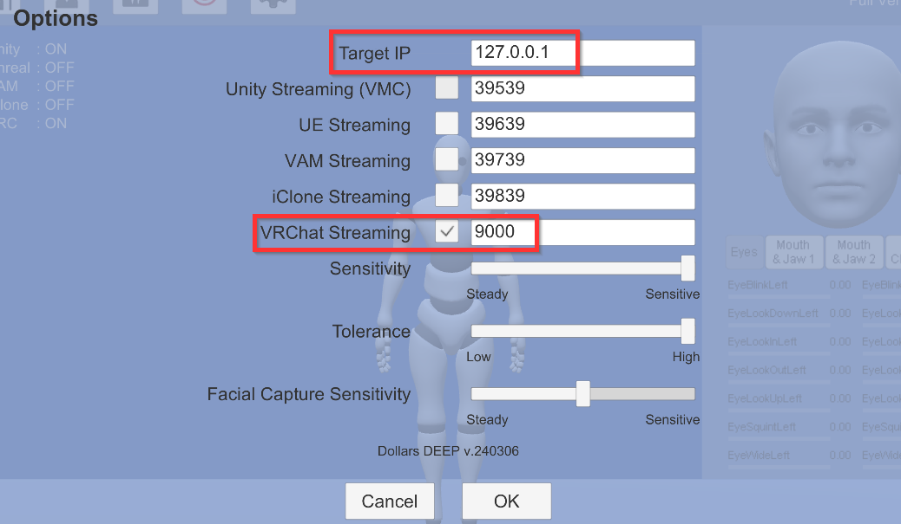
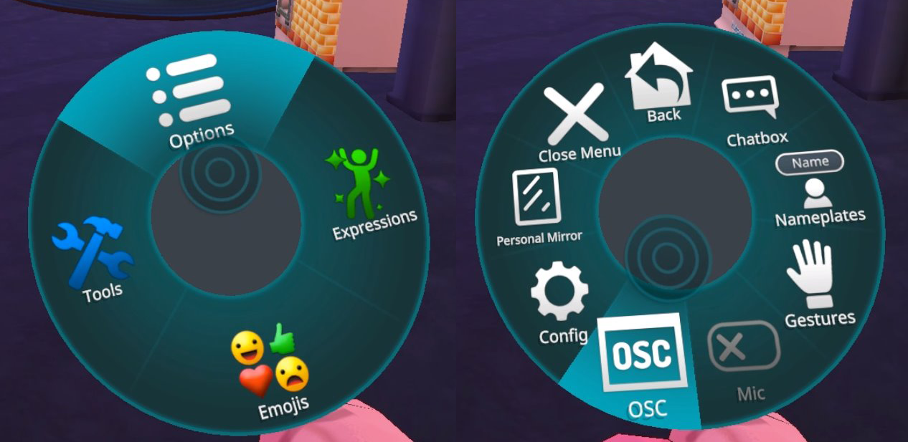
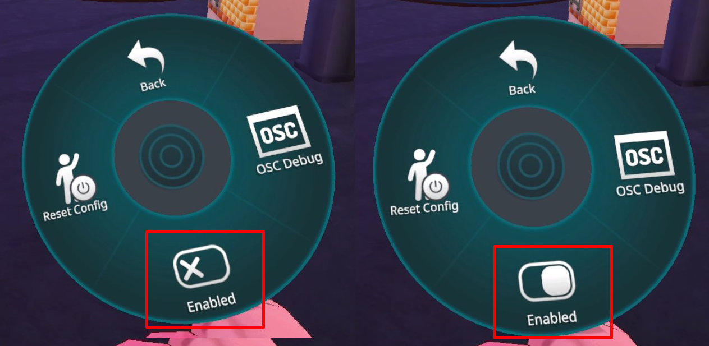
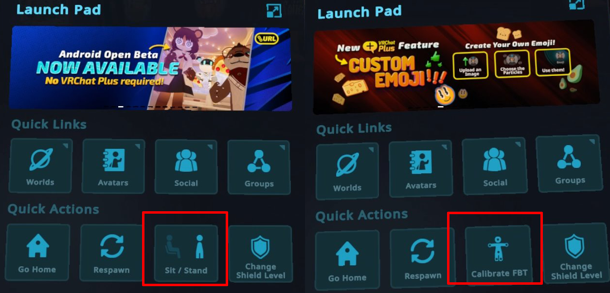
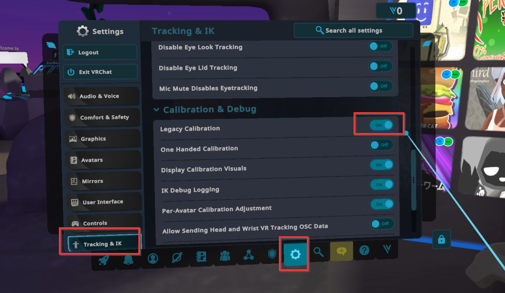
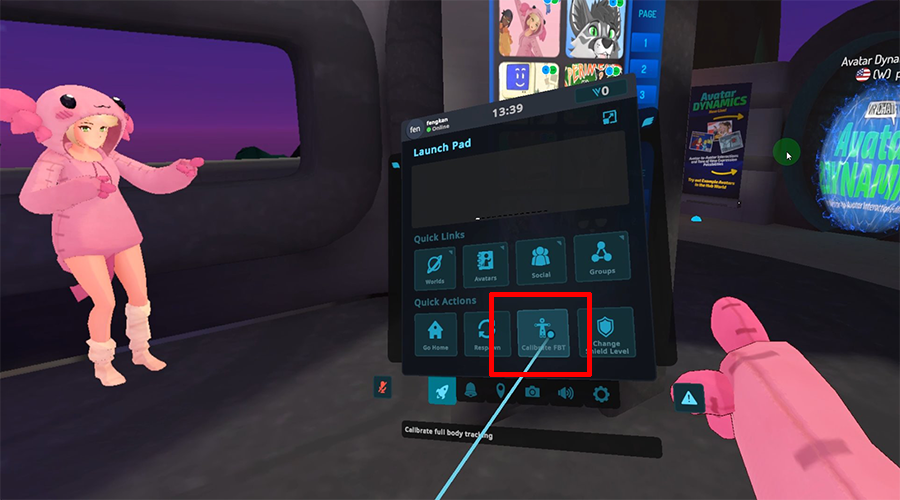
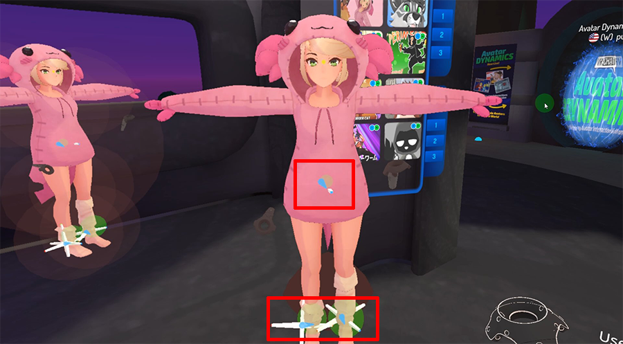

# VRChat フルボディトラッキング

:::info ご注意
以下の Dollars MoCap 製品が VRChat のフルボディトラッキングに対応しています。

- Dollars DEEP（v.240306 以降）
:::

## 準備

### Dollars MoCap 側

VRChat 送信を有効にしてください。必要に応じて、IP アドレスとポートも変更できます。

### VRChat 側

#### OSC を有効にする

Action Menu を開き、**Options > OSC** の順に選択して OSC の設定を開きます。

**Enabled** をクリックして OSC を有効にします。

Action Menu の開き方はコントローラーによって異なります。詳しくは以下の VRChat ドキュメントを参照してください。

https://docs.vrchat.com/docs/action-menu

OSC を有効にすると、Quick Menu の **Sit/Stand** が **Calibrate FBT** に置き換わります。

#### Legacy Calibration モード

また、Settings で **Legacy Calibration** を On にすることをおすすめします。

これで準備は完了です。

## キャリブレーション

Dollars DEEP でキャリブレーションを完了した後、Quick Menu の **Calibrate FBT** をクリックします。

この時点で、腰と脚の位置にトラッカーが表示されるはずです。

その後、両腕を横に伸ばし、左右のコントローラーのトリガーを同時に引くと、キャリブレーションが完了します。
